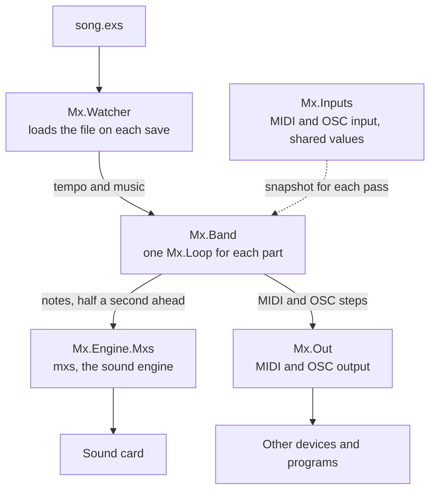

# Architecture

mx is an Elixir application that plays songs written as Elixir files.
Elixir works out what plays and when; mxs, a sound engine in Rust on FunDSP, makes the sound.
The two meet at one boundary, `Mx.Engine`, where Elixir hands mxs events stamped with the time they play at.

## From a song file to sound

`mix mx.play` and the `mx` command start an `Mx.Session` for one song file.
The session is a supervisor of five processes, started in this order:

| Process | What it does |
|---|---|
| `Mx.Engine.Mxs` | Runs mxs through a NIF, live on the sound card. |
| `Mx.Out` | Sends MIDI and OSC to other devices and programs at their time. |
| `Mx.Inputs` | Keeps the latest MIDI and OSC input, and the values loops share. |
| `Mx.Band` | Plays the song's loops together against one shared beat. |
| `Mx.Watcher` | Loads the song file again each time its content changes. |

Stopping the session stops them in reverse order, so the engine stops last and silences every note the band started.

A song file is evaluated as Elixir, and its `song` call gives the tempo and the music, which `Mx.Song` loads.
The functions of `Mx.Music` build the music as plain values and raise as soon as something cannot play, and the loader reports the file and line from that error.
The song's music is split into sections, the items of its outermost `seq`, and each part becomes a loop whose pass `n` plays that part's notes in section `n`.

The band starts one `Mx.Loop` process for each loop.
A loop works out each pass half a second before it starts, through `Mx.Pass`, which is a pure function of the loop, the pass number and a snapshot of the inputs, so the same pass always plays the same notes.
Each note then goes to the engine half a second before it plays, stamped with the Unix time in microseconds of its beat.

A pass that takes longer than that half second to work out is late.
mx drops its notes that are more than a quarter of a beat late, sends the rest, and prints a warning naming the part and how many notes it dropped.
The part plays on, and its next pass is on time once it catches up.

## Time

The band keeps the tempo as a timeline of absolute beats, described in `Mx.Tempo`.
Every loop works out the real time of each note from its beat on that timeline, never by adding up the lengths before it, so no error builds up from note to note and loops of any length keep their place against the same beat.

mxs plays events on its own clock, the sound card's, which drifts from the system's.
`Mx.Engine.Mxs` turns each Unix time into the second at which mxs renders it, following that drift.
`Mx.Clock` is the time the band plays against: the system's while a song plays, and the time the render has reached while `Mx.Render` renders a song offline, 10 ms at a time.
A render runs the same band, loops and engine as playing does, only as fast as the machine goes.

## Changing a song while it plays

Saving the file loads it again, and a version that fails to load prints its error while the playing version carries on.
A changed loop takes over at the end of its own pass, a new loop starts on the next beat, and a removed loop stops at the end of its pass.
A new tempo starts on the first whole beat after the notes already sent, so every loop changes on the same beat.
Saving the file with the same `song(tempo:)` keeps the tempo the music has changed to.
`Mx.Band` has the full rules.

## The engine

The engine is the mxs crate, a Rust library of its own that lives beside mx in the sibling repository `mxs`.
mx reaches it through `native/mxs_nif`, a thin Rustler crate that depends on mxs from crates.io and turns Elixir terms into mxs's types.
That NIF crate is compiled with mx, so building mx needs the mxs repository checked out next to it.

mxs knows synths and effects by name, each with its options declared.
`Mx.Synths` reads that catalog from mxs the first time it is needed, so a song's synth names and options are checked against what mxs declares.
An event is a note of a synth, a sample, or a change to sounds that are playing; `Mx.Engine` lists them.
A part's effects form a chain in mxs that its notes play into, and the chain is replaced only when its effects or the tempo change.

A panic in a NIF call reaches Elixir as an error, as Rustler turns it into one, so the BEAM carries on.
A panic while mxs fills the sound card's buffer turns the output silent and marks the engine failed, instead of ending the process.

## Inputs and outputs

`Mx.Inputs` listens to every MIDI input connected when it starts, and for OSC on the port the song names.
A pass reads one snapshot of the inputs for its whole length, and a loop with `on:` plays a pass each time the input it waits for arrives.
`Mx.Out` sends a song's MIDI and OSC steps, which have no timestamps of their own, by waking just before each is due.

## Live audio and sample rates

mx reads the sound card's input only when the song it starts with has `live_audio`, so other songs never touch the microphone.
A `live_audio` added while playing needs mx restarted.
mxs cannot start with input on when the input and output devices run at different sample rates, as Bluetooth headphones at 24 kHz beside speakers at 48 kHz do.
mx then stops with a message naming the device and the rates it runs at; set both to the same rate in Audio MIDI Setup, or use other devices.
macOS may ask once whether the terminal can use the microphone.

## Other parts of mx

Beside playing, mx turns other material into songs and measures instruments.

- Scores: `mix mx.import` writes a MusicXML score as a song.
- Humming: `Mx.Hum` turns a recording of one voice into notes on beats.
- Measuring: `Mx.Measure`, `Mx.Fit` and `Mx.Spectrogram` compare a synth's sound with recordings, as [instruments.md](instruments.md) describes.
