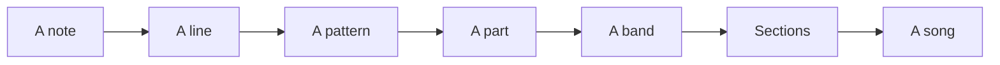

# From a note to a song

This page builds one song in eight steps, from a single note to a band that plays four sections.
Each step is a whole file: save it as `song.exs`, and play it with `mx play song.exs`.
Steps 1 to 3 play to their end and stop.
From step 4 the song repeats until you press Enter, and mx takes up each version you save while it plays.

The song is a maracatu rhythm of Pernambuco under a dub bass line, with a trombone for the tune.
`examples/maracatu_dub.exs` is the same idea at full length.



## 1. A note

```elixir
import Mx

song(tempo: 96, music: part(:trombone, note(:d4, 2), synth: :trombone))
```

`note` plays a pitch for a number of beats: D4, the D above the middle of a piano, for two beats.
`part` gives the note to a player, here mx's trombone.
`song` sets the tempo, 96 beats a minute, and plays the music.

## 2. A line

```elixir
import Mx

line = seq(r: 0.25, a3: 0.75, d4: 1, c4: 0.5, a3: 0.5, f3: 1)

song(tempo: 96, music: part(:trombone, line, synth: :trombone))
```

`seq` plays its items one after another.
Each is a name and a length, and `r` is a rest, a silence.
The line lasts four beats, which is one bar of this song.

## 3. The same line as a pattern

```elixir
import Mx

line = steps(~MX"_ a3:3 d4:4 c4:2 a3:2 f3:4", 0.25)

song(tempo: 96, music: part(:trombone, line, synth: :trombone))
```

A pattern writes music as text on a grid.
`steps` plays it with each step lasting a quarter of a beat, so a bar has sixteen steps.
`_` is a step of silence, and `d4:4` is a D4 that lasts four steps.
This plays the same notes as step 2, and a long tune is easier to read this way.

## 4. A drum

```elixir
import Mx

alfaia = steps(~MX"D...eD..eD..eD.."s, 0.25, strokes: [D: [vel: 0.95], e: [vel: 0.45]])

song(tempo: 96, music: repeat(part(:alfaia, alfaia, synth: :surdo, defaults: [note: 33])))
```

With an `s` after it, a pattern is read one character to a step, which suits a drum.
`.` is silence, and each letter is a stroke that `strokes:` describes: `D` is hit hard and `e` softly, `vel` being how hard.
`repeat` plays the bar again and again until you press Enter, and `repeat(music, 4)` would play it four times.
Change a letter of the pattern and save: the new bar takes over when the one playing ends.
The alfaia is the bass drum of maracatu, played here on mx's surdo.

## 5. Two players at once

```elixir
import Mx

line = steps(~MX"_ a3:3 d4:4 c4:2 a3:2 f3:4", 0.25)
alfaia = steps(~MX"D...eD..eD..eD.."s, 0.25, strokes: [D: [vel: 0.95], e: [vel: 0.45]])

song(
  tempo: 96,
  music:
    repeat(
      together([
        part(:trombone, line, synth: :trombone),
        part(:alfaia, alfaia, synth: :surdo, defaults: [note: 33])
      ])
    )
)
```

`together` starts its items at once.
Everything so far returns music, so it all nests: a `seq` of `together`s, a `repeat` of a `seq`.

## 6. A band, each part declared once

```elixir
defmodule MaracatuDub do
  use Mx.Song, tempo: 96

  @room [reverb: [room: 0.6, mix: 0.2]]

  part :trombone, synth: :trombone, defaults: [vel: 0.6], fx: [echo: [phase: 0.75, mix: 0.25]] ++ @room
  part :bass, synth: :double_bass, defaults: [pizz: 1, vel: 0.8]
  part :gongue, synth: :cowbell, defaults: [amp: 0.4, note: 65], fx: @room
  part :alfaia, synth: :surdo, defaults: [amp: 0.7, note: 33]

  def song, do: repeat(band())

  defp band do
    together(
      trombone: steps(tune(), 0.25),
      bass: steps(bass(), 0.25),
      gongue: repeat(steps(~MX".x..x.x..x..x.x."s, 0.25, vel: 0.7), 2),
      alfaia: repeat(steps(~MX"D...eD..eD..eD.."s, 0.25, strokes: [D: [vel: 0.95], e: [vel: 0.45]]), 2)
    )
  end

  defp tune, do: [~MX"_ a3:3 d4:4 c4:2 a3:2 f3:4", ~MX"g3:4 a3:2 d3:6 _:4"]
  defp bass, do: [~MX"d2:5 _:4 d2:3 _ f2:2 e2", ~MX"d2:5 _:4 a1:3 _ c2:3"]
end
```

A longer song is a module that uses `Mx.Song`.
Each `part` line declares a player once: its synth, the options its notes take unless they give their own, and its effects in order.
`together` then takes the music of each part by its name.
A list of patterns plays as one bar after another, so the tune and the bass are two bars each.
`song` is the function mx plays.

## 7. Sections

Replace `def song` in step 6 with these lines:

```elixir
  def song, do: repeat(seq([call(), riddim(), dub(), riddim()]))

  defp call, do: only(band(), [:gongue, :trombone])
  defp riddim, do: band()
  defp dub, do: without(band(), [:trombone, :gongue])
```

The items of the outermost `seq` are the song's sections, also inside `repeat`.
`only` is the music with just the parts named, and `without` is the music with them left out.
So the trombone calls over the bell alone, the band comes in, and the dub leaves the bass and the drum.
Save the file while it plays, and the new version takes over when the section playing ends.

## 8. The form

```elixir
  def song, do: repeat(form([call: 1, riddim: 2, dub: 1, riddim: 1], &section/1))

  defp section(:call), do: only(band(), [:gongue, :trombone])
  defp section(:riddim), do: band()
  defp section(:dub), do: without(band(), [:trombone, :gongue])
```

`form` states the order of the sections and how many times each plays, and calls one function for each.
That is a whole song: a tempo, parts, sections and their order.

## Where next

- [The cheatsheet](cheatsheet.cheatmd) shows everything the notation can do, a line of code for each.
- [The notation](notation.md) describes each function in full.
- [Instruments](instruments.md) lists the synths and effects with their options.
- [Examples](examples.md) describes the songs in `examples`.
