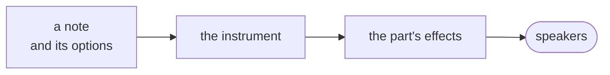

# Instruments

An instrument turns a note into sound.
A part names its instrument with `synth:`, each note gives the instrument options, such as its pitch and how hard it is played, and the sound goes through the part's effects.



There are three kinds of instrument, and a part plays them all the same way.

| Kind | What it is | A part names it as |
|---|---|---|
| One of mx's synths | a sound mx makes itself, most of them fitted to recordings of a real instrument | `synth: :piano` |
| A synth of your own | a sound you describe in Elixir with `defsynth` | `synth: :bell` |
| A sampled instrument | recordings of a real instrument, one file for each key | `synth: sampled(folder)` |

This page first shows how to play an instrument and how to make one, then lists mx's synths and effects with the options each takes, and ends with the commands that measure a synth against recordings.

## Playing an instrument

```elixir
import Mx

tune = seq([note(:c4, 1, vel: 0.3), note(:e4, 1), note(:g4, 2, vel: 0.9)])

song(tempo: 90, music: part(:keys, tune, synth: :piano, defaults: [vel: 0.6]))
```

- `synth: :piano` names the instrument. Without it a part plays `:tri`, a plain triangle wave.
- A note's options, after its length, are for the instrument: `vel: 0.3` is a soft key.
- `defaults:` gives every note of the part options it takes unless the note gives its own.

Each instrument has its own options, and mx checks them when the song loads, before anything plays:

```
song.exs:2: part lead: synth piano has no option wobble, in note(60, 1, wobble: 2)
song.exs:2: part lead: synth piano takes vel from 0.05 to 1, not 3, in note(60, 1, vel: 3)
```

### Options most instruments take

| Option | What it sets |
|---|---|
| `note` | the pitch, which `note(:c4, 1)` gives for you |
| `vel` | how hard the note is played, up to 1: harder is louder and usually brighter |
| `amp` | how loud, whatever the playing |
| `pan` | where the sound is, from -1 for left to 1 for right |
| `attack`, `decay`, `sustain`, `release` | the envelope, how the note's level moves over its life, in beats |

The envelope has four stretches:

```
level
  |      /\
  |     /  \_____________
  |    /                 \
  |___/                   \___
      attack decay sustain release
```

- `note(:c4, 2)` holds the note for its 2 beats, and `release` is how long it then takes to fall silent.
- `attack_level`, `decay_level` and `sustain_level` set the level each stretch ends at.
- An instrument that rings by itself, such as a guitar or a bell, fades as the real one does, and `sustain` and `release` damp it sooner.

### Changing an option while a note sounds

An option with a `_slide` partner can change while the note sounds, as [the notation](notation.md#changing-a-sound-while-it-plays) describes:

```elixir
note(:a4, 4, changes: [{1, note: :c5, note_slide: 0.1}])
```

On the winds and the bowed strings this is how a slur is written: one note whose pitch changes on the same breath or bow.

## Making an instrument

There are four ways to get a new instrument, from the least work to the most.

| You have | Make | With |
|---|---|---|
| recordings of an instrument, key by key | a sampled instrument | `sampled`, in the song |
| a sound in mind | a synth in Elixir | `defsynth`, in the song or a library |
| a synth for mx itself | a synth in mxs | Rust, in the mxs crate |
| a real instrument to imitate closely | a synth fitted to recordings | a synth, and `mx measure` |

### From recordings

`sampled` makes an instrument from a folder of recordings, one key at a time, often at several strengths and in several takes, and a part plays it as it plays a synth.

```elixir
mbira =
  sampled({:vcsl, "Idiophones/Plucked Idiophones/Mbira dzaVadzimu Nyamaropa, Zimbabwe, Low B"})

part(:mbira, seq(e4: 1, fs4: 1), synth: mbira)
```

[The notation](notation.md#sampled-instruments) covers how files are named and chosen, and the collections of recordings mx knows.

### A synth in Elixir

A song or a library defines its own synths with `defsynth`, in a module that uses `Mx.Instrument`.
mxs builds them at run time, so no Rust toolchain is needed, and a synth defined in a song file plays as soon as the file is saved.

**Step 1: a tone.**
A synth is its options, declared with `attr`, and a function from those options to a sound.

```elixir
defmodule Mine do
  use Mx.Instrument

  @doc "A plain tone."
  attr :note, :note, default: 60, doc: "The pitch."
  envelope_attrs()

  defsynth tone(played) do
    sine(hz: hz(played.note))
    |> gain(0.3)
    |> note_envelope(played)
  end
end

import Mx

song(tempo: 90, music: part(:lead, seq(c4: 1, e4: 1, g4: 2), synth: :tone))
```


- `attr` declares one option: its name, its kind, its default and one sentence of documentation.
- `envelope_attrs()` declares the seven envelope options, and `note_envelope` shapes the sound by them.
- `played` holds the note's options, so `played.note` is its pitch.
- The song plays the synth by the name of its function, `:tone`.

**Step 2: options that shape the sound.**
`vel` here makes the note louder and adds an octave above it, so harder is also brighter.
`follow` reads an option as it changes, so a change of `note` glides.

```elixir
attr :note, :note, default: 60, doc: "The pitch, which a change glides."
attr :vel, :float, default: 0.6, range: 0..1, doc: "How hard it is played."
envelope_attrs()

defsynth tone(played) do
  pitch = hz(follow(played.note))
  octave = sine(hz: pitch * 2) |> gain(played.vel)

  mix([sine(hz: pitch), octave])
  |> gain(0.3 * played.vel)
  |> note_envelope(played)
end
```

- `range: 0..1` makes mx refuse a `vel` outside it when the song loads.
- An option is read once, when the note starts, unless the synth reads it with `follow`.

**Step 3: a sound that rings by itself.**
A struck or plucked sound needs no envelope from the note: something sets it ringing and it fades.
This bell strikes three resonators, each a partial of the bell with its own level and fade, and ends with `rings` in place of `note_envelope`.

```elixir
defmodule Bells do
  use Mx.Instrument

  @doc "A small bell, struck once."
  attr :note, :note, default: 72, doc: "The pitch."
  attr :vel, :float, default: 0.6, range: 0..1, doc: "How hard the bell is struck."

  defsynth bell(hit) do
    freq = hz(hit.note)
    strike = impulse()

    partials =
      for {ratio, level, fade} <- [{1, 0, 2.5}, {2.76, -6, 1.2}, {5.4, -12, 0.6}] do
        strike |> mode(hz: freq * ratio, level: db(level), fade: fade)
      end

    mix(partials)
    |> gain(0.2 * hit.vel)
    |> rings(seconds: 3)
  end
end

import Mx

song(tempo: 90, music: part(:bell, seq([note(:c5, 1), note(:e5, 1), note(:g5, 2)]), synth: :bell))
```

Every synth ends with `note_envelope` or `rings`, which tells mxs when the note is over.

**What a synth is built from.**

| For | Use |
|---|---|
| a wave | `sine`, `saw`, `square`, `triangle`, `pulse`, each at `hz:` |
| noise and strikes | `noise(:white)`, `noise(:pink)`, fixed by `seed:`; `impulse()`, or at `at:` and again every `period:` until `until:`; `clicks`, random clicks at a `rate:` a second |
| a set of harmonics | `partials` |
| filtering | `lowpass`, `highpass`, one pole with `poles: 1`, `bandpass`, `lowshelf`, `highshelf`, `peak`, and `mode`, a resonator that rings, many from one input given lists, and gliding given a sound as `hz:` |
| level over time | `gain`, `envelope`, `perc`, `struck`, a decay struck again by each click, and `time()`, which starts over every `every:` seconds |
| combining | `mix`, `delay`, `fed_back`, a delay fed back into itself through filters in its loop, `share`, a sound built once and used several times, and `+` and `*` on sounds |
| reading options | `hz`, `db`, `follow`, `select`, `clamp`, `mod` |
| chance | `draw`, a number drawn as each note starts, and `noise` seeded from the same with `drawn:` |
| ending the note | `note_envelope`, `rings` |
| whole models | `bowed_string`, `air_jet`, `wind_bands`, `vibrato` |

`Mx.Instrument.Vocabulary` documents each of them.

**One rule to know.**
A `defsynth` does not run when a note plays.
When its module compiles, each clause runs once with the note's options as placeholders, and what the body does with them is recorded as a graph, which mxs builds into a sound when a note starts.

- Data written in the module, such as the list of partials above, takes any Elixir.
- An option of the note takes only arithmetic, comparisons, `select/3` and the vocabulary.
- An `if` on an option fails when the module compiles, naming the file and line:

```
song.exs:9: an if cannot depend on the note's options; pick between two values with select(condition, then, else)
```

**Going further.**

- `Mx.Instrument` documents `attr`, `envelope_attrs`, `defsound` for pieces a synth calls, `defeffect` for an effect of your own, and the checks made at each step.
- `examples/trap.exs`, `examples/amapiano.exs` and `examples/funk_br.exs` each define the synths their song needs, such as an 808 bass.
- The folder `test/support/instruments` holds a marimba, a flute and a tabla written this way, as longer examples.
- The folder `test/support/paired` holds mxs's own voices written this way, each checked to render as its Rust form does: `rimshot.ex` is a drum of modes, and `viola.ex` a bowed string, built on `bowed.ex`.

### A synth in mxs

mx's synths are written in Rust, in the mxs crate's `src/synths`, grouped by family: strings, winds, bowed strings, tuned percussion, drums, organs and the basic waveforms.
Each is built from FunDSP's units and mxs's own nodes in `src/nodes.rs`, such as `modes`, a bank of resonators struck by their input, each fading 60 dB over its own time.

A synth is a name, its options, and a function that builds one note's sound from the note's options:

```rust
let plate = Synth::new("plate")
    .option(Spec::note("note").default(60.0).doc("The pitch."))
    .option(Spec::float("vel").default(0.6).range(0.0, 1.0).doc("How hard the plate is struck."))
    .build(|note, _ctx| {
        let freq = hz(note.number("note"));
        let strike = Net::wrap(Box::new(impulse::<U1>()));
        let struck = modes(strike, &[freq, freq * 2.76], &[1.0, db(-6.0)], &[3.0, 1.2]);
        Note::rings(struck * (0.2 * note.number("vel")) as f32, 4.0)
    });
```

mxs's README shows how to register a synth like this one and play it from Rust.

Each option declares its kind, default, range and documentation, and mx reads those declarations to check a song's options before anything plays.
A note returns its sound together with how it ends, `Note::rings` after a number of seconds or `Note::envelope` by the note's envelope, so mxs knows when to free it as soon as it starts.
Changing a synth's shape takes a rebuild of mxs, which compiling mx does.

### After a real instrument

Most of mx's synths imitate a real instrument and were fitted to recordings of it.
Work on one goes through these steps.

1. Find recordings under a free licence, such as the University of Iowa's, VCSL or Freesound's CC0 packs, of single notes or hits at several strengths.
2. Measure them with `mx measure`: `--held` for bowed, blown and organ notes, `--hits` for bars, bells and drums, and plain for plucked and struck strings. It prints each band's level and how fast it fades.
3. Write the design in mxs, and compare it with the recordings by giving `mx measure` the synth with `--synth`.
4. For a struck instrument recorded at many notes and velocities, let `mx fit --struck` fit each recording partial by partial and write the figures mxs plays. For a held one, `mx fit --held` does the same with a list of bowed or blown notes: it follows each note's pitch and vibrato, reads each partial's level through the attack until the note holds, its slope once let go and how far it swings with the vibrato, and the noise in ERB bands, then corrects them against its own renders. `--check` then compares the synth with each recording partial by partial over the attack and where the note holds, and in ERB bands until a second after it is let go. For a synth with a few options of its own, `mx fit` without either searches for the values that bring it closest, and writes them into the design.
5. Pin the figures in `test/mx/designs_test.exs`, whose tests render the synth and measure it the same way, against the recordings' medians written in the test. They are tagged `engine`.
6. Write a solo for it, in `examples/solo` or a folder of its own under `examples`, from real playing practice, and listen. A synth that passes every figure can still sound wrong, and the ear decides.

[Measuring an instrument](#measuring-an-instrument) describes each command's options and what it prints.

## mx's synths

All of them, in alphabetical order:

accordion, acid, bandolim, bassoon, berimbau, brass, cabasa, cajon, cavaquinho, caxixi, cello, clap, clarinet, clave, closed_hihat, cowbell, crash, cross_stick, cuica, deep_bass, double_bass, electric_bass, electric_guitar, electric_piano, flute, flute_figured, fm, ganza, glockenspiel, guiro, guitar, harmonium, harp, high_agogo, high_bongo, high_conga, high_timbale, high_tom, horn, kick, low_agogo, low_bongo, low_conga, low_timbale, low_tom, marimba, mid_conga, mid_tom, noise, oboe, open_hihat, organ, pandeiro, pandeiro_heel, pandeiro_jingles, pandeiro_slap, pandeiro_thumb, pedal_hihat, piano, pluck, pulse, ride, rimshot, saw, shaker, sitar, snare, square, supersaw, surdo, tabla, tabla_ghe, tabla_ke, tabla_na, tabla_tas, tabla_te, tabla_tun, tamborim, tambourine, tambourine_shake, tanpura, tenor_sax, timbale_shell, timpani, tri, triangle, trombone, trumpet, tuba, vibraphone, viola, violin, xylophone.

They are mx's own designs, in mxs's `src/synths`.

Each synth belongs to one family, and each pitched one is meant for a range of notes:

- keys: piano, electric_piano, organ, harmonium, accordion
- plucked strings: guitar, electric_guitar, electric_bass, bandolim, cavaquinho, harp, sitar, pluck, tanpura, berimbau
- bowed strings: violin, viola, cello, double_bass
- winds: flute, oboe, clarinet, bassoon, tenor_sax, trumpet, trombone, horn, tuba, brass, flute_figured
- mallets: marimba, vibraphone, xylophone, glockenspiel, timpani
- synths: tri, saw, square, pulse, supersaw, fm, acid, deep_bass, noise
- drums: every other synth

`Mx.Synths.family(:flute)` gives `:winds`, and `Mx.Synths.range(:flute)` gives `{59, 97}`, the MIDI notes from B3 to D♭7 that its recordings run over.
A synth fitted to recordings is meant for the notes it was fitted to, or further where its section below says so, as the piano's A0 to C8.
A synth with no range of its own, such as `saw` or a drum, gives nil, as do the cavaquinho, bandolim, sitar, tanpura, organ, harmonium, accordion, pluck and brass for now.
A note outside its synth's range still plays.
mxs's catalog of the synths gives each one's family and range.
mx ships none of Sonic Pi's synths, its sc808 drum kit or its effects.

mx's own synths take `note`, `amp`, `pan`, `attack`, `decay`, `sustain`, `release`, `attack_level`, `decay_level` and `sustain_level`, and slides for `note`, `amp` and `pan`.
The sections below give what each takes beyond those, and the recordings it is measured from.

### Basic waveforms

- `saw`, `square`, `tri`, `pulse`, `noise`, `supersaw` and `acid` take `cutoff`, a MIDI note number, and `res`, the filter's resonance from 0 to 1, with slides.
- `pulse` takes `pulse_width`, `fm` takes `divisor`, which sets the modulator to the note's frequency divided by it, and `depth`, and `supersaw` takes `detune` in semitones, each with a slide.
- `pluck` takes `ring`, how many seconds the string rings, and `coef`, from -1 to 1, where higher is duller.

### Piano and plucked strings

- `piano`, `brass`, `flute`, `guitar`, `cavaquinho` and `bandolim` take `vel`, from 0 to 1, how hard the note is played: harder is louder and brighter. A piano note rings on for its `sustain` and fades over its `release`, like a held key; the piano is measured from the Steinway B grand of the Versilian Community Sample Library, from A0 to C8. The piano's `pedal: 1` plays a note with the sustain pedal down, so the strings that share its harmonics ring with it, as on the Steinway's recordings with the pedal; `pedal` defaults to 0 and can differ per note of a chord.
- `piano` takes four more options, measured from the same Steinway.
  - `aftersound`, from 0 to 1 and 0.5 by default, is how far each harmonic fades in two stages, fast after the strike and then slowly, as a piano's strings do: at the default a note is about 10 dB quieter a second after the strike, where the Steinway's is 14 dB quieter, and at 0 every harmonic fades at one rate and the note is 5 dB quieter.
  - `uneven`, from 0 to 1 and 1 by default, is how far each key differs from its neighbours in its harmonics' levels, fades and beating, the same at every strike: at 1 a harmonic's level stands a median 6 dB from the mean of the keys two semitones either side, where the Steinway's stands 5 dB, and at 0 every key follows the same curve.
  - `instrument`, a whole number and 0 by default, is which piano's keys `uneven` draws, each number another instrument.
  - `knock`, from 0 to 1 and 1 by default, is how loud the hammer's knock through the soundboard is, a short sound under 600 Hz that rings at the same frequencies whatever the key; 0 leaves it out.
  - `aftersound: 0, uneven: 0, knock: 0` plays the piano as it was before it had these options.
- `guitar` is a nylon-string guitar measured from recordings of a real one, and reaches down to B1, the low string of a 7-string guitar. A note rings until it fades away by itself, the low notes for over ten seconds, unless `sustain` and `release` damp it.
- `electric_bass` is an electric bass played with the fingers; it takes `vel` as the guitar does. A note rings until it fades by itself, a low one for many seconds and a high one for two or three, unless `sustain` and `release` damp it, and `release` is a tenth of a second unless given, as a finger stops the string. It is measured from the bass_electronic_018 instrument of Google's NSynth dataset, from E1 to D#4, and plays down to A#0.
- `deep_bass` is a darker bass played with the fingers: on A1 its harmonics from 250 Hz to 1 kHz stand about 20 dB lower than `electric_bass`'s, and its fundamental rings almost three times as long. It takes `vel` as `electric_bass` does, and a note rings until it fades by itself unless `sustain` and `release` damp it. It is measured from the bass_electronic_025 and bass_electronic_027 instruments of Google's NSynth dataset, from E1 to D#4, and plays down to A#0.
- `electric_piano` is an electric piano whose hammers strike tines: a note starts with a bell that rings shorter the higher the note, and a harder note is brighter. It takes `vel` as the piano does, and a note rings while held until it fades by itself, unless `sustain` and `release` damp it, as a key let go does. It is fitted partial by partial to the keyboard_electronic_098 instrument of Google's NSynth dataset, from E1 to E6, with `mx fit --struck`, and in ERB bands it is within 0.5 dB of each recording at the median note and 2.7 dB at the worst.
- `electric_guitar` is a solid-body electric guitar picked clean. It takes `vel` as the guitar does, and a note rings until it fades by itself, unless `sustain` and `release` damp it, as a hand muting the string does. It is fitted partial by partial to the guitar_electronic_028 instrument of Google's NSynth dataset, from E2 to D6, with `mx fit --struck`, and in ERB bands it is within 0.3 dB of each recording at the median note and 1.3 dB at the worst.
- `cavaquinho` and `bandolim` have steel strings, brighter and shorter.
- `bandolim` takes `tremolo`, how many times a held note is picked per beat; 0 picks it once.
- `harp` is a folk harp, the kind the Paraguayan and llanera harps are; it takes `vel` as the guitar does. A string rings for many seconds unless `sustain` and `release` damp it; the harp is measured from the folk harp of the Versilian Community Sample Library, from C2 to G#6.

### Tuned percussion

- `marimba` takes `vel`, from 0 to 1: harder is louder, and brings out the overtones the bars are tuned to. A note rings until it fades by itself, the low bars for seconds and the high ones for a fraction of one, unless `sustain` and `release` damp it; the marimba is measured from the University of Iowa's marimba struck with yarn mallets, from F1 to C7.
- `vibraphone` takes `vel` as the marimba does, and `motor`, how many times per beat the motor's pulse comes round, 0 by default, which stops it. A note rings for many seconds unless `sustain` and `release` damp it, as the pedal does; the vibraphone is measured from the University of Iowa's vibraphone, from C3 to F6, played with the motor off.
- `xylophone` takes `vel` as the marimba does. A note is short and bright, and fades by itself in about a second at the bottom and a tenth of a second at the top; the xylophone is measured from the University of Iowa's xylophone struck with rosewood mallets, from F4 to C8.
- `glockenspiel` takes `vel` as the marimba does. A note rings for many seconds unless `sustain` and `release` damp it; the glockenspiel is measured from the University of Iowa's orchestral bells struck with plastic mallets, from C5 to E8.
- `timpani` takes `vel`, how hard the drum is struck: harder is louder and brighter. Its partials stand about 1.49, 1.95, 2.11 and 2.7 times above its note, not at whole multiples, and a stroke rings until it fades unless `sustain` and `release` damp it; it is measured from the five timpani of VSCO 2, from 92 to 190 Hz.

### Bowed strings

- `violin` takes `vel` as the guitar does, `vibrato` as the flute does, 0.25 by default, and `pizz: 1` to pluck the string instead of bowing it. A bowed note swells in over a fraction of a second, slower the softer it is played, and holds for its `sustain`; a plucked note rings until it fades by itself, unless `sustain` and `release` damp it. A bowed note is a model of a bowed string, a waveguide after McIntyre, Schumacher and Woodhouse (1983) and Julius O. Smith III's digital waveguides, and follows its note as it changes, so notes slurred in one bow are one note whose `note` changes. `legato: 1` changes bow from a note still sounding, so the string speaks at once instead of swelling in. `bow_speed` and `bow_force` scale the bow's speed and force at the note's vel, 1 by default, and `bow_position` is where the bow meets the string, as a fraction of its length from the bridge, 0.12 by default. The violin is measured from the University of Iowa's violin, bowed and plucked, from G3 to B7, and VSCO 2's solo violin.
- `viola` takes the same options as `violin`, and is measured from the University of Iowa's viola, bowed and plucked, from C3 to Bb6.
- `cello` takes the same options as `violin`, and is measured from the University of Iowa's cello, bowed and plucked, from C2 to Bb5.
- `double_bass` takes the same options as `violin`, and is measured from the University of Iowa's double bass, bowed and plucked, from E1 to G4, at the pitch it sounds.

### Winds

- The winds, `flute`, `clarinet`, `oboe`, `bassoon`, `tenor_sax`, `trumpet`, `trombone`, `horn` and `tuba`, are physical models: the breath drives an air jet, a reed or the lips at the end of a bore as long as the note's period. A change of `note` while a note holds slurs to the new pitch on the same breath, so a phrase written as one note with changes plays legato, and `note_slide` sets how long each slur takes. A change of `vel` while a note holds swells or fades it, louder and brighter as the breath grows, over `vel_slide`: `note(:c5, 4, changes: [{1, note: :d5}, {2, note: :e5, vel: 1, vel_slide: 2}])` slurs C5, D5 and E5 and swells on E5.
- `flute` takes `vibrato`, the depth of the vibrato that grows as a note holds, in semitones, 0.25 by default and shallower the softer the note; 0 turns it off. The flute is measured from the University of Iowa's flute, from B3 to Db7, and VSCO 2's flute.
- `flute_figured` is the flute played from figures fitted partial by partial to the University of Iowa's flute played with vibrato at pp, mf and ff, and takes `vel` as the guitar does. A change of `note` while a note holds slurs to the new note's figures. It plays the recordings' own vibrato unless given `vibrato`, a depth in semitones, and `inhale: 1` takes a breath once the note is let go, as a player does at the end of a phrase.
- `clarinet` is a Bb clarinet at the pitch it sounds, and takes `vel` as the guitar does and `vibrato` as the flute does, 0 by default. Its low notes are hollow, strong in the odd harmonics, and its notes from A4 up are brighter and louder; a soft note is almost a pure tone. The clarinet is measured from the University of Iowa's Bb clarinet, from D3 to C7, and compared with VSCO 2's clarinet.
- `oboe` takes `vel` as the guitar does and `vibrato` as the clarinet does, 0 by default. Its harmonics are loudest around 1.3 kHz whatever the note, which gives it its nasal sound; the oboe is measured from the University of Iowa's oboe, from Bb3 to Ab6, and compared with VSCO 2's oboe.
- `bassoon` takes `vel` as the guitar does and `vibrato` as the clarinet does, 0 by default. Its harmonics are loudest from 400 to 630 Hz whatever the note; the bassoon is measured from the University of Iowa's bassoon, from Bb1 to D5, and its vibrato from VSCO 2's bassoon.
- `tenor_sax` takes `vel` as the guitar does, and `vibrato`, how deep the vibrato that grows as a note holds is, where 1 is the depth of the recordings played with vibrato and 0, the default, plays without it. It is measured from the tenor saxophone of the Versilian Community Sample Library, from Ab2 to E5, at the pitch it sounds; the recordings reach E6, but the design follows the notes below the altissimo register.
- `trumpet` is a Bb trumpet at the pitch it sounds, and takes `vel` as the guitar does and `vibrato` as the flute does, 0 by default. Its harmonics are loudest around 1.2 kHz, and the harder it is played the more its harmonics above 2 kHz come through; it is measured from the University of Iowa's Bb trumpet, from E3 to Eb6, and compared with VSCO 2's trumpet.
- `trombone` is a tenor trombone, and takes `vel` as the guitar does and `vibrato` as the flute does, 0 by default; `note_slide` glides between notes as the slide does. Played soft it is dark and round, and played hard its harmonics above 1 kHz come through; it is measured from the University of Iowa's tenor trombone, from E2 to C5, and its vibrato from VSCO 2's tenor trombone.
- `horn` is a French horn, and takes `vel` as the guitar does and `vibrato` as the flute does, 0 by default. Its harmonics are loudest from 250 to 630 Hz and fall away fast above 1 kHz, so it is round and dark, and played hard it brightens up to about 1.7 kHz; it is measured from VSCO 2's F horn, from C2 to F5, with how loud each note is following the University of Iowa's horn.
- `tuba` takes `vel` as the guitar does and `vibrato` as the flute does, 0 by default. Its harmonics are loudest from 90 to 250 Hz, soft notes are dark and speak quickly, and loud ones brighten and take longer to speak; it is measured from VSCO 2's tuba, from Bb1 to Bb3, plays down to F1, and how loud each note is follows the University of Iowa's tuba.

### Organs and reeds

- `organ` is a pipe organ measured from VSCO 2's organ: it takes `loud: 1` for its loud set, a principal chorus, instead of its quiet one, a stopped flute, and its `vel` changes only its level, since a pipe sounds the same however hard its key is struck; a note holds one level for its `sustain`.
- `harmonium` is the reed organ pumped by hand that accompanies Hindustani singing, and takes `vel` as the guitar does; it has no vibrato and holds its note for its `sustain`. Its harmonics stand within 7 dB of the fundamental up to 2.5 kHz and fall away above, with the reeds' breathy noise between them about 27 dB below, and it speaks in about a quarter of a second. It is measured from the "Harmonium" pack by cabled_mess on Freesound, cut from "Harmonium Samples - All Keys and Drones" by donyaquick, at C2, C3, A3, C4 and D5, with every band of harmonics and of noise from 80 Hz to 4 kHz within 1 dB of the recordings', as `mx fit --check` scores it.
- `accordion` is an accordion's right hand, the free reeds pressed by bellows that carry the melody in tango, musette and forró, and takes `vel` as the guitar does; it holds its note for its `sustain`. Each note sounds two reeds, the second `detune` Hz above the first, 4 by default, so they beat about four times a second; `detune: 0` sounds one reed, dry. Its harmonics stand up to 9 dB above the fundamental from 250 Hz to 1 kHz and fall away above 1.6 kHz, with the reeds' noise between them 23 to 37 dB below, and it speaks in about 0.05 seconds. It is measured from "Accordeon master" by hammondman on Freesound, at C3, E3, G3, C4, E4, G4, B4 and D5, with every band of harmonics and of noise from 130 Hz to 4 kHz within 4 dB of the recordings' and its attack within 20 percent, as `mx fit --check` scores it, and its beating compared with "Accordion wav samples" by hammondman.

### Tanpura and sitar

- `tanpura` plays a drone with its note as Sa: four strings plucked in turn, Pa a fourth below, Sa twice and Sa an octave below, on beats 0, 2, 3 and 4 of a cycle of six gaps, as the Hindustani pattern goes. `gap` is the time between plucks in beats, 0.8 by default; the drone holds for its `sustain`, 16 beats by default, and the strings then ring out over its `release`. `vel` sets how hard the strings are plucked, and it has no vibrato. Each pluck brings the higher harmonics in over the next second, as the jawari, the strings buzzing on the bridge, does. The tanpura is measured from "Tanpura 10" by sankalp on Freesound, a big tanpura on Db3, with each band's harmonics and the noise between them within 6 dB of the recording's from 80 Hz to 16 kHz. Its body is lower the lower its Sa, as a bigger tanpura's is, but it is still 13 to 20 dB brighter than "Tanpura in E" by iluppai, a flat tanpura on E2, from 160 Hz to 1.6 kHz:

```
$ mx measure --held --drone "Tanpura in E.wav:E2" --synth tanpura
band               level     noise     level     noise     level     noise
80-160 Hz        +0.0 dB   -0.1 dB   +0.0 dB   -2.0 dB   +0.0 dB   -1.9 dB
160-250 Hz       -6.7 dB  -22.0 dB   +5.9 dB   +7.9 dB  +12.7 dB  +29.9 dB
250-400 Hz       -3.9 dB   -3.6 dB  +13.0 dB  +21.9 dB  +16.9 dB  +25.5 dB
400-630 Hz      +15.7 dB   +8.1 dB  +10.7 dB   +8.1 dB   -5.0 dB   -0.0 dB
630-1000 Hz      -4.6 dB   +4.8 dB  +10.5 dB  +16.6 dB  +15.2 dB  +11.9 dB
1000-1600 Hz    -12.2 dB   -1.3 dB   +7.4 dB   +7.3 dB  +19.6 dB   +8.6 dB
1600-2500 Hz    -10.5 dB   -7.4 dB  -10.6 dB   +1.3 dB   -0.1 dB   +8.7 dB
2500-4000 Hz    -15.6 dB   +0.4 dB   -8.2 dB   +6.0 dB   +7.4 dB   +5.6 dB
4000-6300 Hz    -22.1 dB   +0.8 dB  -13.5 dB   +3.4 dB   +8.6 dB   +2.6 dB
6300-10000 Hz   -24.9 dB   -0.4 dB  -23.2 dB   +8.2 dB   +1.7 dB   +8.7 dB
10000-16000 Hz  -28.8 dB  -11.9 dB  -28.7 dB   +1.3 dB   +0.0 dB  +13.2 dB
```
- `sitar` plays a plucked sitar note, which rings until it fades by itself, the lowest harmonics for over ten seconds, unless `sustain` and `release` damp it. Its harmonics reach up to 16 kHz at once and the upper ones fade first, as the jawari, the string buzzing on the bridge, makes them. `sa` is the note its sympathetic strings are tuned to, Sa and its octave, C#3 by default; they ring on quietly after a note on Sa or its octave, and much less after other notes. `note_slide` glides from one note to the next on the same pluck, as meend does, and `vel` sets how hard the string is plucked, harder being louder and brighter. The sitar is measured from "sitar01.flac" on Freesound, its first main string plucked from E3 to G#3, with each band from 160 Hz to 4 kHz within 2 dB of the recording's level and fade. Beside "sitar j" by JOHNWALLY, a different sitar struck hard on G4, its harmonics ring for about half as long:

```
$ mx measure "sitar j.wav:G4" --synth sitar
band          recordings          sitar at vel 0.6    difference
250-400 Hz     22.96 s   +0.0 dB   11.16 s   +0.0 dB    -51%   +0.0 dB
630-1000 Hz    24.28 s   -2.7 dB    9.87 s   +5.1 dB    -59%   +7.9 dB
1000-1600 Hz   16.92 s  -12.3 dB    8.47 s   -4.9 dB    -50%   +7.5 dB
1600-2500 Hz    8.31 s   -6.8 dB    5.35 s  -13.2 dB    -36%   -6.5 dB
2500-4000 Hz    6.96 s  -13.3 dB    3.96 s  -12.2 dB    -43%   +1.1 dB
4000-6300 Hz    5.29 s  -20.2 dB    3.61 s  -29.0 dB    -32%   -8.8 dB
6300-10000 Hz   8.94 s  -32.2 dB    2.44 s  -39.2 dB    -73%   -7.0 dB
10000-16000 Hz       -  -39.7 dB
```

### Drums

| For | Synths |
|---|---|
| the drum kit | `kick`, `snare`, `rimshot`, `cross_stick`, `clap`, `closed_hihat`, `open_hihat`, `pedal_hihat`, `low_tom`, `mid_tom`, `high_tom`, `crash`, `ride` |
| Latin music | `cowbell`, `clave`, `low_conga`, `mid_conga`, `high_conga`, `low_bongo`, `high_bongo`, `low_timbale`, `high_timbale`, `timbale_shell`, played on the timbale's shell for cáscara, `guiro`, `cabasa`, `cajon` |
| samba and maracatu | `surdo`, `cuica`, `tamborim`, the agogô's two bells `low_agogo` and `high_agogo`, `ganza`, and `shaker`, a large shaker |
| choro | `pandeiro`, also played as one stroke each: `pandeiro_thumb` for its low tone, `pandeiro_jingles`, `pandeiro_slap` and `pandeiro_heel` |
| capoeira | `berimbau`, `caxixi` |
| Hindustani music | `tabla`, its dayan also played as `tabla_na`, `tabla_tun`, `tabla_te` and `tabla_tas`, and its bayan as `tabla_ghe` and `tabla_ke` |
| any music | `tambourine`, struck, `tambourine_shake`, shaken, and `triangle` |

- A drum plays its own pitch with `hit()`, or `hit(amp: 0.5)` with options, and takes `note` to retune it, `amp` and `pan`.

**The drum kit**

- `snare` takes `vel`, how hard it is struck: harder is louder, puts more into the head and less into the wires, and the softest strokes are dark; it is measured from the snare of Versilian Studios' VSCO 2 Community Edition with its snares on.
- `crash` takes `vel`, how hard it is struck: harder is louder and dies sooner below 1.2 kHz, as on the crash cymbal of Versilian Studios' VSCO 2 Community Edition it is measured from; it rings for 9 seconds and fades over one, and a shorter `sustain` and `release` choke it.
- `closed_hihat` and `open_hihat` take `vel`, how hard the hi-hat is struck: harder is louder and brighter, as on the hi-hat of the Versilian Community Sample Library they are measured from; the open one rings for 5 seconds, and a shorter `sustain` and `release` close it, as the pedal does.
- `low_tom`, `mid_tom` and `high_tom` take `vel`, how hard the tom is struck: harder is louder and brighter, as on the high and low toms of the Versilian Community Sample Library that `high_tom` and `low_tom` are measured from; `mid_tom` is the high tom tuned between them.

**Latin percussion**

- `low_conga`, `mid_conga` and `high_conga` take `vel`, how hard the drum is struck: harder is louder and brighter, as on the tumba, conga and quinto of Versilian Studios' VSCO 2 Community Edition they are measured from. They take `mute`, from 0 for an open tone to 1 for a stroke damped as the recordings' finger taps are, 24 to 32 dB quieter and ringing mostly above 400 Hz, and `slap`, from 0 for an open tone to 1 for a slap, which the recordings don't have.
- `low_bongo` and `high_bongo` take `vel`, how hard the drum is struck, and `muted: 1` for a muted stroke; they are measured from the bongos of the Versilian Community Sample Library, whose muted strokes ring about as long as the open ones.
- `cowbell` takes `vel`, how hard it is struck, and `muted: 1` for a stroke the hand mutes; it is measured from the cowbells of VSCO 2 Community Edition and the Versilian Community Sample Library. Harder is louder and duller, as on the recordings, and a muted stroke loses the bell's ring near 470 Hz but keeps its upper modes, so it sounds brighter, not shorter.
- `clave` takes `vel`, how hard the sticks strike: harder is louder and brighter, as on the claves of the Versilian Community Sample Library and VSCO 2 Community Edition it is measured from; a stroke rings near 2 kHz, falling 15 dB in its first 50 ms and fading over 0.7 s.
- `guiro` takes `sustain`, the length of its scrape in beats, and `vel`, how hard it is scraped: harder is louder and brighter, as on the University of Iowa's güiro; it is measured from that güiro and the güiros of VSCO 2 Community Edition and the Versilian Community Sample Library. The stick crosses about 55 ridges in a full scrape, so a longer scrape is slower, from 125 ridges a second down to 40.
- `cabasa` takes `vel`, how hard it is struck, and `rub: 1` to turn the beads against the cylinder for its `sustain` instead of striking them; it is measured from the cabasa of the Versilian Community Sample Library.
- `cajon` takes `vel`, how hard it is played, and `slap`, from 0 for the bass tone to 1 for the slap, as the congas do; it is measured from the cajón of the Versilian Community Sample Library.
- `ganza` and `shaker` take `vel`, how hard the stroke is, and `up: 1` for an up stroke instead of a down stroke; they are measured from the small and the large shaker of the Versilian Community Sample Library.
- `tambourine` takes `vel`, how hard it is struck: harder is louder, rattles longer and is fuller below 1 kHz, as on the University of Iowa's three tambourines it is measured from; VSCO 2's tambourine is much quieter from 250 Hz to 1.6 kHz, so the design follows Iowa's. `tambourine_shake` takes `vel` and `sustain`, the length of its shake in beats.
- `triangle` takes `vel`, how hard it is struck: harder is louder and brighter, as on the University of Iowa's 6- and 8-inch triangles it is measured from. It rings for up to ten seconds, and `sustain` and `release` damp it as a hand closing on it does, sooner on its highest modes; `sustain: 0` with a `release` of about 1.1 s fades as the Versilian Community Sample Library's muted strokes do, and the forró triangle's closed strokes take a release of about 0.15.

**Samba, choro and capoeira**

- `surdo` is the large drum that holds samba's beat, struck with a felt mallet, and takes `vel`, how hard it is struck, and `muted: 1` for the stroke with the hand on the head, which loses the drum's lowest ring, sounds higher and fades in half the time. With no `note` it is the surdo de primeira, ringing on 66.6 Hz with a ring at twice that 10 dB down; `note` tunes it, so `note: 41` and `note: 45` are the higher surdos de segunda and de terceira. It is measured from three loops by plotzki on Freesound, and compared with igorfiche01's surdo, a higher drum.
- `cuica` is the friction drum of samba. Each stroke is played back from the nearest of 28 strokes measured in reinsamba's pack "Cuica" on Freesound, its pitch and each of its harmonics moving as that stroke's did, and no stroke comes twice running where another is as near. `note` is the note the stroke settles at, 65.65 with none: the recordings' low strokes, with the head free, are near notes 64 and 65, and the high ones, with it pressed, between 76 and 80. `vel` is how hard the stick inside it is rubbed, which also brightens it. With no `sustain` the stroke is one played alone, which whoops up into its note and leaves the head ringing after it; `sustain` makes it one of a run of strokes and is how long it lasts, so that strokes played one after another join as the stick turns. `scoop` is the semitones under its note the stroke starts, and below 0 the stroke falls into its note from above; with none it starts as the recorded stroke did.
- `tamborim` is the small high drum of samba struck with a stick, and takes `vel`, how hard it is struck. It rings on 524 Hz with no `note`, with peaks at 1.8 and 2.5 times it and a crack of noise above 3 kHz; `note` tunes it. It is measured from "Tamborim Sound.ogg" by Samba-x on Wikimedia Commons.
- `low_agogo` and `high_agogo` take `vel`, from 0 to 1, how hard the bell is struck: harder is louder and brighter, as on the Versilian Community Sample Library's agogô they are measured from.
- `pandeiro_thumb`, `pandeiro_heel`, `pandeiro_slap` and `pandeiro_jingles` take `vel`, how hard the stroke is, and `muted: 1` for a finger of the holding hand pressed on the head from behind, so it rings higher and shorter; they are measured from pandeiro recordings on Freesound, except the muted head, which is chosen by ear.
- `pandeiro` plays any of those strokes, named by `stroke`: `thumb`, the default, `heel`, `slap` or `jingles`.
- `berimbau` plays an open stroke, `coin: 1` the stroke with the coin pressed to the string, a semitone higher, and `buzz: 1` the buzzed stroke, the coin resting on the wire so the string dies within a fifth of a second under its rattle; it takes `vel`, how hard the stick strikes, harder being louder and brighter, and `note` tunes the open string, D#2 by default, as the jam it is measured from. It is measured from "Berimbau jam without caxixi" by EliasArtista on Freesound, each band within 6 dB of the jam's as it is struck and 50, 100 and 200 ms after with the gourd held still, with its partials on the string's harmonics and the 3rd and 5th strongest, as the gourd brings them out. `gourd` is how many times a second the gourd opens and closes against the belly while the string rings, swinging its 5th harmonic against its 3rd as uiop's "berimbau.aif" on Freesound does; it is 2.3 by default, as on that recording, and 0 holds the gourd still. No open recording has buzzed strokes, so the buzz is designed rather than measured; there is no bend of the coin pressed while the string rings.
- `caxixi` is the woven basket shaker that a capoeira berimbau player shakes in the bowing hand, and takes `vel`, how hard it is shaken, and no `note`. Each shake is loudest above 2.5 kHz and falls 10 to 17 dB in its first 50 ms, and its strongest peak moves from shake to shake, between about 1.7 and 9.6 kHz. It is measured from "Caxixi.ogg" by Freddythehat on Wikimedia Commons, a large and a small caxixi shaken together.

**Tabla**

- `tabla_na`, `tabla_tun`, `tabla_te` and `tabla_tas` are the dayan's strokes, and `tabla_ghe` and `tabla_ke` the bayan's; each takes `vel`, how hard the stroke is, harder being louder and brighter. A dayan stroke's `note` tunes the drum to Sa, D#4 by default, and `tabla_ghe` takes `note` with `note_slide` to bend the bayan while it rings, as the palm does. Play dha, dhin and the other strokes of both hands by playing a dayan and a bayan stroke on the same beat. They are measured from the "tabla bols" pack by mmiron on Freesound, each band within 6 dB and 30 percent of the fade of the recordings' from 250 Hz to 8 kHz, and from 80 Hz to 4 kHz for `tabla_ghe`; `tabla_ke`, whose recordings are too short to measure as hits, follows their spectrum and is silent 0.1 seconds after it is struck.
- `tabla` plays any of those strokes, named by `bol`: `na`, the default, `tun`, `te`, `tas`, `ghe` or `ke`; its `note` is the stroke's own unless given.

## Effects

A part's `fx:` sends its sound through effects, in the order written:

```elixir
part(:keys, tune, synth: :piano, fx: [echo: [phase: 0.75, mix: 0.3], reverb: [decay_seconds: 1.8]])
```

The song's own `fx:` takes the same effects, and every part plays through them after its own, as [The song](notation.md#the-song) describes.
A bus takes them too, for parts to share one effect with `send:`, as [Buses](notation.md#buses) describes.


These are mx's own designs, in mxs's `src/effects.rs`, with option names that follow Sonic Pi's.
bitcrusher and chorus follow Airwindows' DeRez and Chorus, as `LICENSE-designs.md` credits.

bitcrusher, bpf, chorus, compressor, distortion, echo, eq, flanger, hpf, level, limiter, lpf, pan, phaser, ping_pong, pitch_shift, reverb, rlpf, slicer, tremolo, wobble.

Every effect takes `amp`, `mix` from 0 for dry to 1 for wet, and `pre_amp`, the level going in.
An effect's time is in beats and follows the tempo unless its name ends in `_ms`, for milliseconds, or `_seconds`: a tremolo with `phase: 1` pulses once a beat at any tempo, and a slicer's `smooth_ms: 20` takes 20 ms at any tempo.
`amp`, `pre_amp` and `mix` are plain factors, not decibels, and so is a send's level.
The options in decibels are the compressor's `threshold` and `makeup`, the limiter's `ceiling` and the `gain` of each of the equaliser's bands.
A frequency, such as `cutoff` or `centre`, is a MIDI note number.
`wave` is the shape of a sweep: 0 saw, 1 pulse, 2 triangle, 3 sine and 4 cubic; `invert_wave: 1` turns it upside down, and `phase_offset` is where in the cycle it starts, from 0 to 1.
- `bitcrusher` takes `sample_rate`, the rate in Hz it holds samples at, `bits`, how many it rounds each to, and `cutoff`, a MIDI note number for a low-pass after it, off at 0. Its song is `examples/effects/bitcrusher.exs`.
- `bpf` takes `centre`, the MIDI note number of the band it keeps, and `res`, from 0 to 1, the higher the narrower. Its song is `examples/effects/bpf.exs`.
- `chorus` takes `phase`, how long the delay takes to sweep back and forth, `decay`, how long the delayed sound feeds back, and `max_phase`, the longest `phase` it can change to. Its song is `examples/effects/chorus.exs`.
- `compressor` turns down what is louder than `threshold`, in dB below full scale, -18 unless given: above it the sound comes out 1 dB louder for each `ratio` dB it rises, 4 unless given. `makeup`, in dB, raises the sound afterwards, and `clamp_ms` and `relax_ms`, 10 and 150 unless given, are how long it takes to turn down and to let go. It follows the louder of the two sides and turns both down alike. `key:` names a part or a bus whose level it follows in place of its own, so `part(:pad, chords, synth: :organ, fx: [compressor: [key: :kick, threshold: -24, ratio: 8]])` drops the pad each time the kick plays, and the kick sounds as it would without it. Its song is `examples/effects/compressor.exs`.
- `distortion` takes `distort`, from 0 to 1. Its song is `examples/effects/distortion.exs`.
- `echo` takes `phase`, the time between echoes, `decay`, how long they take to die away, and `max_phase`, the longest `phase` it can change to. Its song is `examples/effects/echo.exs`.
- `eq` is an equaliser of three bands, each a list of its own options: `fx: [eq: [low: [at: 48, gain: -6], mid: [at: 72, gain: 4, q: 2], high: [gain: 3]]]`. `low` raises or lowers everything below its `at`, `high` everything above its `at`, and `mid` a peak around its `at`, the narrower the higher its `q`, 1 unless given. `at` is a MIDI note number, 36 for `low`, 60 for `mid` and 96 for `high` unless given, and `gain` is in dB, 0 unless given, so a band that is not given changes nothing. A change names the band the same way, `change({:bass, :eq}, mid: [gain: -8, gain_slide: 2])`. Its song is `examples/effects/eq.exs`.
- `flanger` takes `phase`, `wave`, `invert_wave` and `phase_offset` for its sweep, `stereo_invert_wave: 1` to sweep the left channel the other way, `delay_ms` and `depth_ms`, the delay it sweeps up from and how far, `max_delay_ms`, the longest delay, `feedback` from 0 to 1 and `decay` for how strongly and how long the delayed sound feeds back, and `invert_flange: 1` to subtract the delayed sound instead. Its song is `examples/effects/flanger.exs`.
- `phaser` sweeps notches with no pitch of their own through the sound. It takes `phase`, `wave`, `invert_wave` and `phase_offset` for its sweep, a sine unless given, `stages`, 2, 4, 6 or 8, one notch for every two and 4 unless given, `low` and `high`, the notes it sweeps between, 60 and 108 unless given, `feedback` from 0 to 0.95, which raises the sound between the notches, and `stereo_invert_wave: 1` to sweep the left channel the other way. Its notches are deepest at `mix: 0.5`, half the dry sound and half the phaser's, which is its `mix` unless given, and at `mix: 1` it cuts none. `stages` is read when the part starts. Its song is `examples/effects/phaser.exs`.
- `hpf` and `lpf` take `cutoff`, a MIDI note number. Their songs are `examples/effects/hpf.exs` and `examples/effects/lpf.exs`.
- `level` takes only what every effect takes, and sets a part's level with `amp`. Its song is `examples/effects/level.exs`.
- `limiter` holds every peak under `ceiling`, in dB below full scale, -1 unless given: it reads 5 ms ahead, turns both sides down alike just before a peak on either would pass, and lets them back up over `relax_ms`, 100 unless given. Its sound comes out 5 ms late, so a part through it plays 5 ms behind the others, and a song through it starts 5 ms later. Its song is `examples/effects/limiter.exs`.
- `pan` takes `pan`, from -1 for left to 1 for right. Its song is `examples/effects/pan.exs`.
- `ping_pong` echoes between left and right: `phase` is the time between echoes, `feedback` how much of each echo the next keeps, `max_phase` the longest `phase` it can change to, and `pan_start` the side of the first echo, from -1 for left to 1 for right. Its song is `examples/effects/ping_pong.exs`.
- `pitch_shift` takes `pitch`, how many semitones the sound is shifted by, from -24 to 24, and delays the sound by up to 40 ms. Its song is `examples/effects/pitch_shift.exs`.
- `reverb` is a room around the sound. It takes `size`, the room's size in metres, 20 unless given, `decay_seconds`, the time its sound takes to fade 60 dB, 2 unless given, `predelay_ms`, the gap before the room starts, `low_cut`, the note below which the room is cut, 0 for none, and `damp`, from 0 to 1, how much the room dulls the highs. A sound's room is louder on the sound's own side. `size` and `predelay_ms` are read when the part starts. Its song is `examples/effects/reverb.exs`.
- `rlpf` takes `cutoff`, a MIDI note number, and `res`, from 0 to 1, how much it rings at its cutoff. Its song is `examples/effects/rlpf.exs`.
- `slicer` turns the sound on and off: `phase` is the length of a cycle, `pulse_width` the part of it that is on, `amp_min` and `amp_max` the levels off and on, `phase_offset` where in the cycle it starts, from 0 to 1, and `smooth_ms` how long each change takes. Its song is `examples/effects/slicer.exs`.
- `tremolo` takes `phase`, `wave`, `invert_wave` and `phase_offset` for its sweep, and `depth`, from 0 to 1, how far it turns the sound down. Its song is `examples/effects/tremolo.exs`.
- `wobble` sweeps a resonant filter between `cutoff_min` and `cutoff_max`, MIDI note numbers, once a `phase`, with `res`, `wave`, `invert_wave`, `phase_offset`, `pulse_width` for wave 1, and `filter`, 0 for low-pass and 1 for high-pass. Its song is `examples/effects/wobble.exs`.
- Every option that takes a number along a range, rather than a choice or a longest value, has a `_slide` partner. A choice, such as `wave`, `invert_wave`, `stereo_invert_wave`, `invert_flange` and `filter`, goes over to its new value at once when a change gives it one, or within 10 ms where a jump would click. `max_phase` and `max_delay_ms` set the longest value when the part starts, and a change to them does nothing.

### An effect in Elixir

`defeffect` in a module that uses `Mx.Instrument` defines an effect from the same nodes as a synth, and a song applies it by name with `fx:`.
`attr` lines before it declare its options, each read from the second argument, and `follow/1` makes an option glide when a song changes it.

An effect whose first argument is one sound shapes each side on its own:

```elixir
defmodule Shaky do
  use Mx.Instrument

  attr :phase, :beats, default: 0.5, doc: "How long one sweep takes."
  attr :depth, :float, default: 0.5, range: 0..1, doc: "How far it turns the sound down."

  defeffect shaky(sound, opts) do
    sound * (1 - follow(opts.depth) * sweep(length: follow(opts.phase), wave: 3))
  end
end
```

An effect whose first argument is a pair takes both sides and returns both, so one side can reach the other:

```elixir
defmodule Narrow do
  use Mx.Instrument

  attr :width, :float, default: 0.5, range: 0..1, doc: "From 0, both sides the same, to 1, as they came in."

  defeffect narrow({left, right}, opts) do
    middle = (left + right) / 2
    width = follow(opts.width)
    {middle + (left - middle) * width, middle + (right - middle) * width}
  end
end
```

An effect sounds on for one second after its input stops, which is how long a render keeps it after the last note.
`tail` beside the `attr` lines says otherwise: `tail 2.0` for two seconds, or `tail :decay` for as long as the option `decay` says, in its own unit.
Besides a synth's nodes, an effect has `sweep/1`, a level from 0 to 1 in the five waves of tremolo, `follower/2`, the level of a sound, `allpass/2` and `lag/2`, and a synth can call them too.
An effect cannot yet feed its own sound back into itself, so an echo and a reverb are still written in mxs.

## Measuring an instrument

These are the commands the steps under [After a real instrument](#after-a-real-instrument) use.

### Plucked and struck strings

mx's guitar was made by measuring recordings of a real guitar and fitting the design to the figures, and `mx measure` takes the same measurements, so a design can be compared with the instrument it imitates.
Give it recordings of single notes, plucked or struck, each file followed by a colon and the note it starts on.
A file may hold several notes one after another a semitone apart, each starting from silence, as the University of Iowa's guitar recordings at https://theremin.music.uiowa.edu/MISguitar.html do.

```sh
mx measure Guitar.mf.sulA.A2B2.aif:A2 Guitar.mf.sulE.E2B2.aif:E2
mx measure Guitar.mf.sulA.A2B2.aif:A2 --synth guitar --vel 0.6
```

It prints the notes it found in each file, with their pitch and how far their harmonics are stretched sharp, then for each frequency band the median seconds a harmonic takes to fade 60 dB and its level in dB against the fundamental of the lowest note.
`--synth` renders one of mx's synths offline at each note found, at `--vel`, and prints its figures beside the recordings', with the difference.
`--option` gives the synth another option as a name and a number, such as `--option up=1` for a shaker's up stroke, and may be given more than once.
The guitar's design tests check the same figures, measured the same way.

`--partials` with a count, such as `--partials 20`, measures the note each file starts with partial by partial instead of by bands, as `Mx.Measure.partials/2` describes, over its first 2.9 seconds.
It follows each partial every 2.5 ms, the harmonics and the peaks between them, such as a tine's bell, up to 8 kHz or the highest the recording holds, while it stands 10 dB above the noise floor of its third of an octave.
It prints up to that many of the strongest, lowest first, each with its frequency, its ratio to the pitch, its harmonic number or "between", its level against the loudest as the note starts, and how it falls in dB a second, with a second slope after the knee where it slows.
It then names each line left out: a partial between harmonics with no strike and hardly any fall, such as a hum in the recording, which is not the instrument.

```sh
mx measure keyboard_electronic_098-064-025.wav:E4 --partials 20
```

### Held notes and hits

Recordings of held notes, bowed, blown or played on an organ, take `--held`, and recordings of hits, on bars, bells and drums, take `--hits`.
A file of hits with no pitch needs no note after its name.

```sh
mx measure --held Flute.vib.mf.B3B4.aiff:B3 --synth flute
mx measure --hits Cowbell1_Hit_v1_rr1_Sum.wav --synth cowbell
```

With `--held`, it prints each note's pitch, attack and vibrato, then their median attack, the seconds until a note first reaches its held level, and their median vibrato, its rate and its depth in cents.
For each band it prints the level of the harmonics while the note holds and the level of the noise between them, the breath of a flute or the bow of a violin.
`--drone` with `--held` measures each file as one note held from its first sample to its last, for a drone plucked again and again, such as a tanpura, which would otherwise read as a note at each pluck.
With `--hits`, it prints each hit's strongest peaks as ratios to the lowest, which shows the partials of a bar or a bell whatever its pitch, then for each band the seconds it takes to fade 60 dB and its level as the hit starts, against the loudest band.
With `--synth`, a held note renders for as long as the recordings hold it, and a hit renders once at each note given, each with only the options the synth takes.
`--partials` with a count adds, under each hit, up to that many of its strongest partials within 40 dB of the loudest, lowest first, each with its frequency in Hz, its ratio to the lowest, its level against the loudest, and the seconds it takes to fade 60 dB; these are the figures a struck instrument's design is written in, such as the agogô's in mxs's `src/synths/drums.rs`.
With `--synth`, the synth's partials print the same way under its name, after the recordings'.

```sh
mx measure --hits Agogo_Low_v1_rr1_Mid.wav --partials 12 --synth low_agogo
```

`mx parts` prints the same figures for a note of mx's piano without playing it: the harmonics the piano works out from its options, before any sound exists, and builds the note from.
Each harmonic prints as a partial does under `--partials`, with its level against the loudest harmonic and the seconds it takes to fade 60 dB, followed by the partners that ring beside the harmonics, each the slow stage of a harmonic's fade or a twin that beats against it, then the hammer's thump and its knock through the soundboard.
`--note`, `--vel` and `--pedal` give the note, and the piano's other options are given the same way.

```sh
mx parts piano --note 60 --vel 0.6
```

### The first moments of a hit

`--hits` then prints each band's level at 0, 50, 100 and 200 ms after the hit's loudest moment, against the loudest band then, as medians over the hits, with the synth's beside them when one is given.
A moment after the next hit starts or the recording ends prints as -, and a level more than 40 dB down prints as -40, so a recording's noise floor does not count as a difference.
These moments catch what the fade misses, such as a hiss that holds its level and then stops: the pandeiro passed every band's level and fade with such jingles, and did not sound like a pandeiro.
`--compare` with a file name writes a WAV file to listen to: up to three recorded hits whose bands are nearest the median, then the synth's hit three times, each 0.6 seconds at the same peak and fading out over its last 10 ms, with a quarter of a second between.
It prints which recorded hits it took, by file and second.

```sh
mx measure --hits "pandeiro A.wav" --synth pandeiro_thumb --compare thumb.wav
mx spectrogram thumb.wav
```

### Spectrograms

`mx spectrogram FILE` draws a spectrogram of a recording into a PNG image beside it, with seconds across and octaves up the side; `--out` names the image.
Several files are drawn into one image, one above another, so a render can be compared with a recording moment by moment.
`--from` and `--seconds` draw a stretch of each, `--per-second` sets the pixels a second takes, and `--window` the milliseconds of sound in each column: the usual long window tells the harmonics apart, and a short one, such as 4, shows how the level moves within a note and where notes join.

```sh
mx spectrogram "cuica (2).wav" solo.wav --from 1 --seconds 2.4 --per-second 400 --window 4
```

`--width` gives the image's width in pixels in place of `--per-second`, and `--no-seconds` leaves out the line at each second, which suits a whole song in one image.
A column that covers more sound than its window shows the loudest level each frequency reaches in the sound it covers, so a narrow image skips no note.

```sh
mx spectrogram song.wav --width 1500 --no-seconds
```

### Levels over time

`mx levels FILE` gives the same picture as numbers, for a video or a light that reacts to what was played: comma-separated values with a first line naming the columns, then a row for each moment, 30 a second unless `--per-second` gives another count.
Each row has its second, the level of the whole sound and of each octave of the spectrogram's side, from 20 Hz to 20,480 Hz, all in dB under the recording's loudest row, and the brightness, the frequency half the sound's energy lies under.
A row covers all the sound from its second to the next, so no stroke falls between two rows.
`--strokes` prints instead the second each sound starts, where the spectrum rises sharply, and its level under the loudest stroke's, so a key struck again while it still rings is a stroke of its own.

```sh
mx levels performance.wav --per-second 60 > levels.csv
mx levels performance.wav --strokes
```

### Strokes that run together

An instrument played in strokes that run into one another, such as the cuíca, takes `--strokes`, and a file needs no note after its name.
It prints each stroke with its number, the second it starts at, its length, the note it settles at, the cents it starts from that note, and its level under the loudest.
`--tracks` with the numbers of strokes of one file prints each one's tracks instead: its pitch in cents against its note every 8 ms, and at each of those steps the levels of its first 16 harmonics and of the noise the harmonics leave, in dB under its loudest step.
`--alone` carries on into the ring a stroke played by itself leaves, and `--ignore` with two frequencies leaves out the harmonics between them, for a steady tone in the recording that is not the instrument's.

```sh
mx measure --strokes "cuica (2).wav"
mx measure --strokes "cuica (2).wav" --tracks 17,19 --ignore 8500-9100
```

The tracks are for an instrument whose bands' levels and fades can be matched by a design that still does not sound like it.
The cuíca's design passed its figures as a fixed set of harmonics under one envelope and sounded synthetic, because in a real stroke each harmonic moves by itself, the level holds and is then cut off, and strokes join with no gap.
Its synth instead plays the measured strokes back: mxs's `src/synths/drums/cuica.rs` holds the tracks this command prints for 28 strokes, and the synth picks the stroke nearest the note, scoop and length asked for, and plays it at that note with harmonics that follow the tracks and filtered noise at the noise's level.
To judge such a synth, draw a stretch of a recording above a stretch of its render with `mx spectrogram`, once with the long window and once with a short one, and look at them before measuring anything.

### Fitting a held instrument

`mx fit` searches for the numbers a held instrument's design needs.
Write each unknown number in the design as a temporary option of the synth, such as `k_odd`, rebuild, then give the synth, each dynamic as `--vel` and the files played at it, and each option as a `--control` with its starting value and step.
A step written with an x, such as `x1.15`, multiplies and divides instead of adding and subtracting.

```sh
mx fit clarinet --vel 0.3 BbClar.pp.D3B3.aiff:D3 BbClar.pp.C4B4.aiff:C4 --vel 1 BbClar.ff.D3B3.aiff:D3 BbClar.ff.C4B4.aiff:C4 --from 160 --control k_odd=-2:2 --control k_att=0.15:x1.15
```

It leaves out notes found below the lowest note given, and stretches whose fundamental stands more than 25 dB below the rest of their dynamic, the breaths and key clicks between notes.
It renders the synth at every semitone from the lowest note to the highest, at each dynamic's vel, each note held as long as the recordings' notes at that dynamic hold, and scores how far each band's harmonics and the noise between them, from `--from` up to 4 kHz, fall more than 4 dB from the recordings', and how far the attack falls more than 20 percent from theirs.
It tries each control a step up and a step down, keeps whichever lowers the score, goes through the controls three times, and prints the best values, to write into the design in place of the controls.
`--check` scores the starting values instead, with no control needed, and prints each band's level of harmonics and of noise in the recordings and how far the synth is off, marking those beyond 6 dB, and each attack beyond 30 percent.
`--drone` measures each file as one note, as `mx measure --held --drone` does, and leaves out the attack, since a drone's recording starts wherever it was cut.
The recordings' figures are kept in the system's temporary folder and reused until a file changes.

### Fitting a struck instrument

`mx fit --struck` fits a struck or plucked instrument from recordings of its notes, given as a folder or as a list.
A folder holds single notes, one file a note and velocity, named as Google's NSynth dataset names them, ending in the MIDI note and the velocity, such as `keyboard_electronic_098-064-025.wav`.
A list is a text file with a line for each recording: its notes, its velocity from 1 to 127, `kept` when the recordings keep their levels from one velocity to the next, and the file.

```text
# Iowa's marimba, each file a run of notes a semitone apart
C4:B4 40 kept Marimba.yarn.pp.C4B4.aif
C4:B4 127 kept Marimba.yarn.ff.C4B4.aif
# the folk harp names its strings an octave below what they sound
C4 127 kept EWHarp_Normal_C3_v3_RR1.wav
# a drum with no pitch, given its lowest partial
125.6Hz 127 kept Timpani3_Hit_v4_rr1_Sum.wav
```

The notes are one note, a run from the first to the last a semitone apart, or the notes a run holds, such as `C4,D4,E4`.
A run is split at each strike, and each piece is matched to the note it sounds; the task prints the notes it found in each file, the notes it did not find, and each piece it left out and why, such as a note that sounds an octave or more than 50 cents from its name, or one struck again louder.
A drum given in Hz is measured with that frequency as its pitch, and its figures go under the nearest MIDI note.
`--struck` can be given more than once, to fit the recordings of several folders or lists into one synth.

The fit measures each recording partial by partial, as `mx measure --partials` does, then corrects each partial's level at 37 times over the note, up to 28 seconds, until a render of the partials measures as the recording does, and fits the strike's noise in bands one ERB wide, bands as wide as the ear's own, from 50 Hz to 8 kHz.
A note is followed for as long as it rings in its recording, up to 30 seconds, or 2.9 seconds in an NSynth folder, whose notes are let go at 3 seconds; after that each partial falls on at its last slope.
Before setting a refit's criteria, run `mx measure --known`: it measures notes with known partials in the same way, a fast strike partial, a beating pair and a slowly building fundamental among them, and prints how far the measuring is from the truth for each.
No fit comes closer to a recording than the measuring follows it, so a criterion on what it cannot follow cannot be met.
`--out` writes the figures, every partial of every recording, to a file for mxs to play; a note or velocity that was not recorded takes its figures from the recordings nearest it, across velocity first and then along the keyboard.
`--notes` with two notes, such as `E1:E6`, keeps the recordings from the first to the second.

```sh
mx fit electric_piano --struck keyboard_electronic_098 --out electric_piano.mxf
mx fit electric_piano --struck keyboard_electronic_098 --notes E1:E6 --check
```

`--check` renders the synth at each recording's note and velocity and compares it with that recording, each brought to the same total over its first half second.
Partial by partial, it takes the gap over the first 20 ms and the mean gap over the note while either stands 10 dB above the recording's floor; in ERB bands, it takes the mean gap over the note.
The synth is read at its own pitch, each partial at the recording's frequency moved by the cents between the two fundamentals and each band moved with it, so a synth in tune is not counted off against a recording a few cents from its name.
It prints the share of the partials within 30 dB of each note's loudest that are within 2 dB at the strike and on average, the share of those 30 to 60 dB down within 4 dB on average, and the ERB gap at the median note and the worst.
For the recordings marked `kept`, it prints how far each velocity is under the loudest at its note over the first half second, in the recordings and in the synth.
It reports the tuning apart from the levels, as "pitch: the recordings +13.2 cents from their names at the median note, synth +0.0, furthest at cs4 vel 80, +0.1", and names each note the synth plays more than 5 cents from its name.
Then it prints the ten partials and the ten notes furthest off, so a single note's miss shows rather than hiding in a median.
A recording against itself delayed by 1 ms measures 0.1 dB at the median note in ERB bands, and the same pitch recorded at a neighbouring velocity 4.7 dB, which sounds like a different note.

Each figure is followed by the same figure for the fit's own render, each recording's figures played as sines and noise with no synth, such as "91% within 2 dB over the first 20 ms, the fit 93%".
The fit's figure is the most a synth playing those figures can reach, so a refit's criterion above it cannot be met, and a gap between the two is the synth's to close.
`--own` with `--check` prints the fit's figures alone and renders no synth, so it runs before the refit is in the engine; the fit's checks are kept in the system's temporary folder and reused until the recording or mxs changes.

```sh
mx fit marimba --struck marimba.txt --check --own
```

`--note` and `--vel` with `--check` print one recording beside the synth and the fit's own render, frame by frame, to see where a note goes wrong.
It prints the note's measured pitch, its cents from the note's name and the second of the file its strike was found at.
Then for each partial within 60 dB of the loudest and each ERB band, it prints rows of levels every 5 ms from 5 ms before the strike to 100 ms after: the recording, the synth, the fit's own render, and that render's sines and noise apart, so a level the fit gets from its noise rather than its sine shows.
At one partial's frequency the sine and the noise add with their phases, so the two rows sum to the fit's own only where one is 20 dB under the other; across a band they add nearly as powers.
`--until` with seconds carries the rows on to that time in 24 steps, `--own` leaves out the synth, and `--csv` with a file name also writes the figures as a table, one line for each partial or band, row and time.

```sh
mx fit marimba --struck marimba.txt --check --note C2 --vel 80
```

```text
c2 vel 80: 65.18 Hz, -6.1 cents from c2, struck at 0.399 s in Marimba.yarn.mf.C2B2.aif
levels in dB against the loudest partial over the first 20 ms, - at or under the recording's floor

ms               -5      0      5     10     15     20     25     30     35     40
1.000 harmonic 1
  recording   -11.9   -9.7   -7.8   -6.1   -4.5   -3.1   -1.9   -0.8    0.2    1.1
  synth        -9.3   -7.6   -6.1   -4.7   -3.5   -2.4   -1.4   -0.6    0.2    1.0
  the fit      -9.8   -8.0   -6.4   -5.0   -3.8   -2.7   -1.7   -0.8    0.0    0.8
    sines      -9.8   -8.0   -6.4   -5.1   -3.8   -2.7   -1.7   -0.8    0.0    0.8
    noise         -      -      -      -      -      -      -      -      -      -
```

`--tour` writes a WAV file to listen to: twelve recordings spread across the notes and velocities, or as many as `--count` gives, each followed by the synth at the same note and velocity.
Each part starts 50 ms before its strike, lasts as long as the recording measured, and is brought to the same level over its first half second, with a second of silence after it.

```sh
mx fit electric_piano --struck electric_piano.txt --tour electric_piano_tour.wav --count 8
```

To compare two versions of a synth, write a tour and a check from the same list on each, the released mxs and the refit, and listen to the tours one after the other.
The recordings in both tours are the same, so the synth's parts are what differ.
