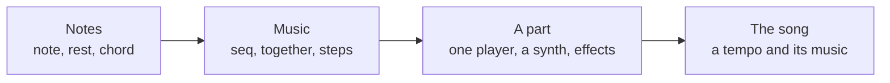
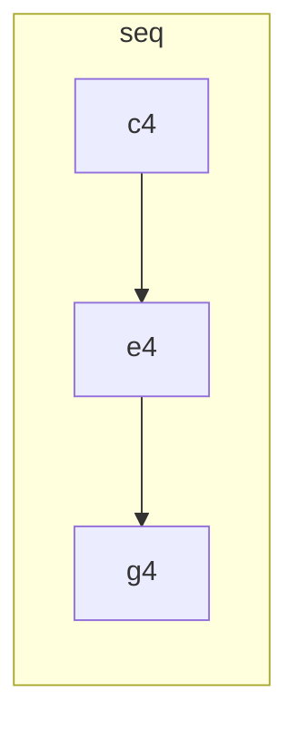
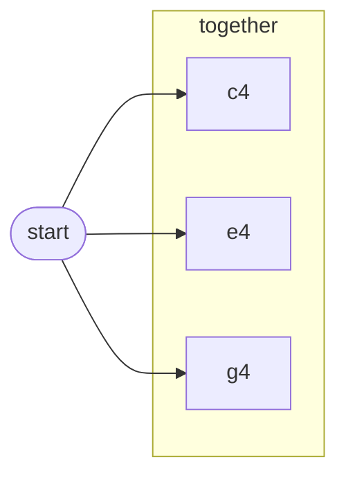
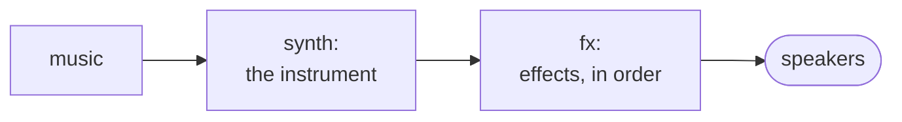
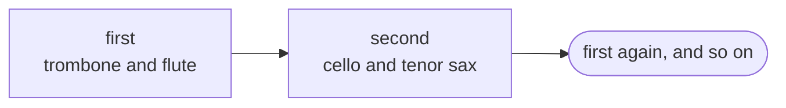
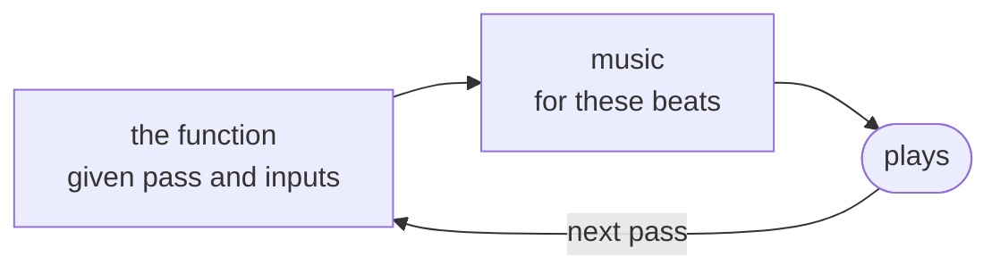

# The notation

A song is an Elixir file that starts with `import Mx` and ends with `song`.
Between the two, plain functions build the music: each returns a value, and `song` plays the value it is given.

```elixir
import Mx

melody = seq(e4: 1, g4: 1, a4: 2, g4: 1, e4: 1, d4: 2)
bass = seq(a2: 4, e2: 4)

song(
  tempo: 90,
  music:
    together([
      part(:flute, melody, synth: :flute, fx: :reverb),
      part(:bass, bass, synth: :double_bass)
    ])
)
```

`mix mx.play song.exs` plays the file.
`mix mx.print song.exs` prints each part's notes with their beats instead of playing them.

This page goes from one note to a whole song, in the order you would learn it.



## A little music first

Skip this section if you read music.

A note has a pitch and a length.

- The pitch is how high the note sounds, and it has a name: a letter from A to G and the number of its octave. C4 is the C in the middle of a piano.
- An octave is the distance from one C to the next C above it. C5 sounds like C4, only higher.
- Between the letters are the sharps and flats, the black keys of a piano: F sharp is just above F, and B flat just below B.
- Every pitch also has a number, which goes up by one for each key of the piano, black or white. C4 is 60, so the D above it is 62 and C5 is 72.

| Name | C4 | D4 | E4 | F4 | G4 | A4 | B4 | C5 |
|---|---|---|---|---|---|---|---|---|
| Number | 60 | 62 | 64 | 65 | 67 | 69 | 71 | 72 |

The length is counted in beats.

- A beat is the pulse you would tap your foot to.
- The tempo is how many beats pass in a minute. At 120 a beat lasts half a second, and at 60 a whole second.
- A length is a number of beats: 1 is one beat, 0.5 half of one, and 4 is four.

Several notes sounding at once are a chord, and a scale is the set of notes a tune is made from.

## Notes

`note` is one note: a pitch, and how many beats it lasts.
`rest` is silence for some beats.

```elixir
note(:a4, 1.5)
rest(1)
```

A pitch is a name or a number.

- A name is a letter from `a` to `g`, an optional `s` for sharp or `b` for flat, and an optional octave, which is 4 unless given.
- `:c4` is 60, `:fs3` is 54 and `:eb3` is 51.

Options after the length go to the synth that plays the note:

```elixir
note(:a4, 1.5, amp: 0.8, release: 2)
```

Each synth has its own options, which [Instruments](instruments.md) lists.
`attack`, `decay`, `sustain`, `release` and every option ending in `_slide` are measured in beats, so `release: 1` lasts one beat at any tempo.

### Chords

A list of pitches is a chord, and `chord` builds the list from its lowest note and its kind:

```elixir
note(chord(:c4, :major), 2)
note(chord(:e3, :minor), 1, strum: 0.05)
note([40, 47, 52, 56], 1, vel: [0.8, 0.6, 0.5, 0.45])
```

- `strum:` starts each note of the chord that many beats after the one below it. A negative strum goes from the highest note down.
- An option given as a list has one value for each note of the chord.

## One after another, and at once

Two functions put music together.
`seq` plays its items one after another.
`together` starts its items at once.





`seq` takes a list of music, or note names and lengths, where `r` is a rest:

```elixir
seq([note(:c4, 1), note(:e4, 1), note(:g4, 2)])
seq(c4: 1, e4: 1, g4: 2, r: 1)
```

`together` takes a list, and lasts as long as its longest item:

```elixir
together([seq(c5: 2, b4: 2), seq(e4: 4)])
```

The two nest, so a song is built from small pieces with names:

```elixir
verse = seq(c4: 1, e4: 1, g4: 2)
chorus = together([seq(c5: 2, b4: 2), seq(e4: 4)])

seq([verse, transpose(verse, 5), repeat(chorus, 2)])
```

- `repeat(music, 4)` plays the music four times. `repeat(music)` plays it until mx stops, and can only hold the whole of a song's music.
- `transpose(music, 12)` moves every note an octave up.
- `delay(music, 7)` is the music after 7 beats of silence, so inside `together` it starts 7 beats after the rest.
- `beats(music)` is the length of music in beats.

## Parts

A `part` is music played by one player.
It has a name, its music, the synth that plays it, and the effects its sound goes through.



```elixir
part(:soprano, melody, synth: :oboe)
```

- The synth is `:tri`, a plain triangle wave, unless given. [Instruments](instruments.md) lists the others.
- A part of one name is the same player wherever it appears in the song, so it must have the same options each time.

`fx:` sends the part through an effect, or through a list of effects in order, each with its options:

```elixir
part(:keys, music, synth: :piano, fx: :reverb)
part(:keys, music, synth: :piano, fx: [echo: [phase: 0.75], reverb: [room: 0.8]])
```

`defaults:` gives every note of the part options it takes unless the note gives its own:

```elixir
part(:guitar, music, synth: :guitar, defaults: [amp: 0.55])
```

## The song

`song` is the last line of the file: a tempo and the music.

```elixir
song(tempo: 72, music: music)
```

The tempo is 60 beats a minute unless given.

### Sections

The items of the song's outermost `seq` are its sections, also when the `seq` is inside `repeat`.
A part plays only in the sections that hold it, so instruments can take turns.



```elixir
import Mx

melody = seq(c4: 1, e4: 1, g4: 2)
answer = seq(r: 2, g5: 1, e5: 1)

first = together([part(:trombone, melody, synth: :trombone), part(:flute, answer, synth: :flute)])
second = together([part(:cello, melody, synth: :cello), part(:tenor_sax, answer, synth: :tenor_sax)])

song(tempo: 72, music: repeat(seq([first, second])))
```

- When you save the file while the song plays, the new version takes over at the end of the current section.
- A song whose music is not a `seq` is one section.

### Changing the tempo

`tempo(140)` changes the tempo for every part from the beat where it is written, and takes no time.
`tempo(130, over: 16)` gets there evenly over 16 beats.

In music that repeats, give the first section its tempo too, since each change comes round again:

```elixir
repeat(seq([tempo(100), verse, tempo(140), chorus]))
```

### What mx refuses

A function refuses what cannot play, such as an unknown note name or an option the synth does not have.
mx prints the refusal with the line of the song file, and a song that is already playing keeps its previous version.

### A song as a module

A longer song reads better as a module that uses `Mx.Song` in place of ending with `song`:

```elixir
defmodule Paredao do
  use Mx.Song, tempo: 92

  part :kick, synth: :kick, fx: [level: [amp: 0.6]]
  part :bass, synth: :double_bass, defaults: [amp: 0.5]

  def song, do: seq([intro(), beat(), beat()])

  defp intro, do: part(:kick, kick(2))

  defp beat do
    together([
      part(:kick, kick(4)),
      part(:bass, steps(~MX"g1:3 _ g1:3 _ bb1:3 _ d2:2 f2:2", 0.25))
    ])
  end

  defp kick(bars), do: repeat(steps(~MX"9...9...9..59.7."s, 0.25), bars)
end
```

- `use Mx.Song` imports `Mx`, and takes the options of `song` except `music:`.
- `song/0` returns the song's music, and mx calls it when it loads the file.
- `part :kick, synth: :kick` in the module's body declares a part with its options, once.
- `part(:kick, music)` in a function is that part playing the music, with the options it was declared with.

A part that is not declared, and a part declared twice, do not compile, and mx names the line.
A file holds one such module; a module that uses `Mx.Instrument` can stand beside it.
`examples/funk_br.exs` is a whole song written this way.

`mix format` keeps a declaration without parentheses when the project's `.formatter.exs` has `import_deps: [:mx]`.

## Rhythm

A drum plays hits, not notes: it has its own pitch.
`steps` writes a rhythm as text, one character for each step.

```elixir
part(:kick, steps("x... x... x... x.x.", 0.25), synth: :kick)
```

Each character lasts a quarter of a beat here, so sixteen of them are four beats:

```
beat   1    2    3    4
       x... x... x... x.x.
```

- An `x` is a hit, a dot is silence, and spaces are left out.
- A digit is a hit at that level, 9 the loudest: `"9..5 9.7."`.

Hits can also be placed by their beat:

```elixir
part(:cajon, at([{0, hit(slap: 1, vel: 0.8)}, {1.5, hit(vel: 0.5)}], 2), synth: :cajon)
```

- `hit(vel: 0.5)` is one hit of a drum at its own pitch, taking no time.
- `at([{0.5, music}, {1.5, music}], 2)` is music of 2 beats that starts each item at its beat, so hits at known beats need no rests between them.
- `swing(music, fun)` starts each note at the beat the function returns for the beat it was written on, so some notes can be pushed late and others early.

## Patterns

A pattern is music written as text, and `steps(pattern, step)` plays it, each step of the pattern lasting `step` beats.
`~MX` writes a pattern, and reads it when the song compiles, so a bracket left open or a length that is no number is refused with its line before anything plays.

```elixir
steps(~MX"g4:2 _ g4 bb4:2 _ a4 | g4:4 - -", 0.25, vel: 0.8)
steps(~MX"9... 9... 9..5 9.7."s, 0.25)
```

### A word to a step

Without a modifier, `~MX` reads a word to a step.

| Written | Plays |
|---|---|
| `g4`, `fs5` | that note |
| `_` | silence |
| `-` | the word before it, one step longer |
| `g4:2`, `g4:1.5` | the note for two steps, or one and a half |
| `g5/b4` | both notes together |
| `[f f]` | two notes in the time of one step |
| `eb2:2 ~g2:2` | one note of four steps that glides to G halfway |

A word after `~` is not struck: the note before it glides to that pitch and lasts through it.
A bar line, `|`, is only for reading.

### A character to a step

With the modifier `s`, as in `~MX"9..5 x..."s`, it reads a character to a step: a dot is silence, and spaces and bar lines are left out.
A plain string given to `steps` is read the same way.

### What the words sound like

A pattern says nothing of what its words sound like; the options of `steps` do:

```elixir
steps(~MX"9...9..5"s, 0.25, sample: "kick.wav", release: 0.1)
steps(~MX"ccoc ccoc"s, 0.25, strokes: [o: [vel: 0.75, sustain: 0.2], c: [vel: 0.5]])
steps(~MX"..1. .5.3"s, 0.25, notes: [:g4, :a4, :bb4, :c5, :d5])
steps(~MX"x.xx"s, 0.25, each: fn step -> [vel: if(step == 0, do: 0.9, else: 0.5)] end)
steps(~MX"eb2:2 ~g2:2 d2:4", 0.25, slide: 0.3)
```

- `x` is a hit of a drum at its own pitch.
- A digit is a hit at that level, 9 the loudest. It sets `vel:`, or the option `digit:` names.
- `sample:` plays each hit as that sample, where a digit sets `amp:`.
- `strokes:` gives the options of other characters or words, so a drum's strokes can have their own letters.
- `notes:` makes a digit a hit tuned to that note of the list, counted from 1.
- `each:` is a function of the step a sound starts on, counted from 0, that returns more options for it. A function of two takes the sound's length in steps as well.
- `slide:` is how many beats a glide takes.
- Any other option goes to every sound.

### Joining patterns

A pattern is a list, so two patterns join with `++`, and `steps` plays a list of patterns as one bar after another:

```elixir
kick = [~MX"9...9...9..59.7."s, ~MX"9..59...9..59.7."s]
part(:kick, repeat(steps(kick, 0.25), 4), synth: :kick)
```

A sigil takes no interpolation; build a longer pattern by joining shorter ones.

## Loops

A `loop` works its music out again on every pass, so a part can vary from pass to pass.
`loop(4, fn pass, inputs -> music end)` runs the function every 4 beats and plays the music it returns.



```elixir
import Mx

drums =
  loop(16, fn pass, _ ->
    last_bar = if rem(pass, 4) == 3, do: "x.x.xxxx", else: "x...x..."
    steps("x...x... x...x... x...x... " <> last_bar, 0.5)
  end)

song(tempo: 96, music: together([
  part(:bass, repeat(seq(c2: 4, g2: 4), 8), synth: :saw),
  part(:drums, drums, synth: :kick)
]))
```

- `pass` counts the passes the loop has played, from 0, and `ring(list, pass)` steps through a list one item per pass.
- Beside other music a loop plays until the longest of the rest ends. Alone, or beside only loops, it plays until mx stops, unless `times: 4` gives its number of passes.
- Music shorter than the loop is followed by silence until the next pass, and music longer than the loop is refused.
- A pass that raises prints its error, and the loop plays its next pass.
- `mix mx.print song.exs --pass 4` prints the fifth pass.

### Inputs

`inputs` holds what has arrived from outside.

| Field | Holds |
|---|---|
| `inputs.cc` | the latest value of each MIDI controller |
| `inputs.notes` | the velocity of the latest note on for each note |
| `inputs.osc` | the arguments of the latest message to each OSC address |
| `inputs.values` | each shared value |

An entry is nil until something has sent it.

```elixir
part(:bass, loop(1, fn _, inputs -> note(:c2, 1, cutoff: (inputs.cc[74] || 64) * 50) end), synth: :saw)
```

mx works a pass out half a second before it plays, so an input that changes shows from the next pass on.

### Playing live

A loop can also play a pass each time something arrives, as soon as possible:

```elixir
loop(fn trigger, _ -> note(trigger.note, 1) end, on: :midi_note)
```

- `on: :midi_note` waits for notes, `on: :midi_cc` for controller changes, and `on: {:osc, "/hit"}` for messages to that address.
- `trigger` is what arrived: `%{note: 60, velocity: 100}`, `%{number: 74, value: 64}`, or `%{address: "/hit", args: [1]}`.

## Recordings

A song plays recordings as well as synths, in two ways.
`sample` plays one recording, as it is or cut up.
`sampled` makes an instrument out of many recordings of one, and a part plays it like a synth.

### Naming a recording

There are three ways to name a recording, and they work in both `sample` and `sampled`.


```elixir
sample("kick.wav", 1)
sample({:sonic_pi, :bd_haus}, 1)
sample({:vcsl, "Idiophones/Struck Idiophones/Agogo Bells/Agogo_High_v1_rr1_Mid.wav"}, 1)
sample({:github, "owner/repo", "main", "drums/kick.wav"}, 1)
```

- A string is the path of a WAV, AIFF or FLAC file. A path that does not start at the root is read from the folder mx runs in.
- `{collection, name}` is a recording of a collection mx knows by name, which [Collections](#collections) lists.
- `{:github, repo, ref, path}` is a file of any public GitHub repository, at a commit, tag or branch.

mx downloads a recording into your cache when the song loads, and plays it from the cache after that.

### Samples

`sample({:sonic_pi, :bd_haus}, 1)` plays the sample, then a beat passes.

```elixir
sample({:sonic_pi, :loop_amen}, 4, beats: 4)
sample({:sonic_pi, :loop_amen}, 1, from: 0.5, to: 1.0)
sample({:sonic_pi, :loop_amen}, 0.5, slices: 8, slice: 3)
sample({:sonic_pi, :ambi_choir}, 4, rate: 0.5, amp: 0.6)
```

- `rate: 0.5` plays at half speed an octave lower, and a negative rate plays backwards.
- `beats: 4` plays the sample faster or slower so it lasts 4 beats at the tempo, in place of `rate`.
- `from` and `to` cut the sample at seconds into its file, and `start` and `finish` cut it at positions from 0 to 1.
- `slices: 8, slice: 3` plays the fourth of eight equal pieces, counted from 0.
- `normalize: true` scales the sample so its loudest moment reaches full scale before `amp`, for files recorded at very different levels.
- A sample also takes `amp`, `pan` and the envelope options `attack`, `decay`, `sustain` and `release`.

### Sampled instruments

`sampled(folder)` makes an instrument from a folder of recordings, one file for each key, and a part plays it with `note` and `hit` as it plays a synth:

```elixir
mbira = sampled({:vcsl, "Idiophones/Plucked Idiophones/Mbira dzaVadzimu Nyamaropa, Zimbabwe, Low B"})
part(:mbira, seq([note(:e4, 1), note(:fs4, 1), note(chord(:e3, :major), 2, strum: 0.05)]), synth: mbira)
```

- mx reads each file's note, strength and take from its name, as the VCSL library names them: `MBira4_pluck_Main_E4_19_50_100_rr2.wav` is the mbira's E4, take 2.
- A note plays the recorded key nearest to it, sped up or slowed down to its pitch.
- `vel` from 0 to 1 picks among the recorded strengths, and repeated notes play the takes in turn.

For files named another way, list them with what each one is:

```elixir
sampled([{"low.wav", note: :c2}, {"high.wav", note: :c3, strength: 2, take: 1}])
sampled([{{:salamander, "Samples/C4v8.flac"}, note: :c4}])
```

### Collections

A collection is a set of recordings mx knows by name.

`:sonic_pi` is Sonic Pi's sample pack, 206 samples under Creative Commons 0.
Its samples are named by atoms, the names of the files in [Sonic Pi's samples folder](https://github.com/sonic-pi-net/sonic-pi/tree/v5.0.0/etc/samples) without the extension: `{:sonic_pi, :loop_amen}`.
It is downloaded whole, once, before a song can play it:

```sh
mix mx.samples.download sonic_pi
```

Every other collection is a public GitHub repository, pinned to one commit so a song sounds the same each time.
Its files and folders are named by their path in the repository.
Each repository states its own license.

| Collection | Repository |
|---|---|
| `:freepats_button_accordion` | [freepats/button-accordion-HN](https://github.com/freepats/button-accordion-HN) |
| `:freepats_electric_guitar` | [freepats/electric-guitar-FSBS-clean](https://github.com/freepats/electric-guitar-FSBS-clean) |
| `:freepats_fm_piano` | [freepats/fm-piano1](https://github.com/freepats/fm-piano1) |
| `:freepats_lately_bass` | [freepats/lately-bass](https://github.com/freepats/lately-bass) |
| `:freepats_spanish_guitar` | [freepats/spanish-classical-guitar](https://github.com/freepats/spanish-classical-guitar) |
| `:freepats_synth_brass` | [freepats/synth-brass-1](https://github.com/freepats/synth-brass-1) |
| `:freepats_synth_choir` | [freepats/synth-pad-choir](https://github.com/freepats/synth-pad-choir) |
| `:freepats_synth_percussion` | [freepats/synthesizer-percussion](https://github.com/freepats/synthesizer-percussion) |
| `:freepats_synth_square` | [freepats/synth-square](https://github.com/freepats/synth-square) |
| `:freepats_synth_strings` | [freepats/synth-strings-1](https://github.com/freepats/synth-strings-1) |
| `:freepats_upright_piano` | [freepats/upright-piano-KW](https://github.com/freepats/upright-piano-KW) |
| `:karoryfer_big_rusty_drums` | [sfzinstruments/karoryfer.big-rusty-drums](https://github.com/sfzinstruments/karoryfer.big-rusty-drums) |
| `:karoryfer_bigcat_cello` | [sfzinstruments/karoryfer-bigcat.cello](https://github.com/sfzinstruments/karoryfer-bigcat.cello) |
| `:karoryfer_black_and_green_guitars` | [sfzinstruments/karoryfer.black-and-green-guitars](https://github.com/sfzinstruments/karoryfer.black-and-green-guitars) |
| `:karoryfer_caveman_cosmonaut` | [sfzinstruments/karoryfer.caveman-cosmonaut](https://github.com/sfzinstruments/karoryfer.caveman-cosmonaut) |
| `:karoryfer_gogodze_phu` | [sfzinstruments/karoryfer.gogodze-phu-vol-i](https://github.com/sfzinstruments/karoryfer.gogodze-phu-vol-i) |
| `:karoryfer_growly_bass` | [sfzinstruments/karoryfer.growlybass](https://github.com/sfzinstruments/karoryfer.growlybass) |
| `:karoryfer_horse_pulse` | [sfzinstruments/Karoryfer.HorsePulse](https://github.com/sfzinstruments/Karoryfer.HorsePulse) |
| `:karoryfer_merry_orks` | [sfzinstruments/karoryfer.272-merry-orks](https://github.com/sfzinstruments/karoryfer.272-merry-orks) |
| `:karoryfer_shiny_guitar` | [sfzinstruments/karoryfer.shinyguitar](https://github.com/sfzinstruments/karoryfer.shinyguitar) |
| `:karoryfer_sneaky_bass` | [sfzinstruments/karoryfer.sneakybass](https://github.com/sfzinstruments/karoryfer.sneakybass) |
| `:karoryfer_squid_pipes` | [sfzinstruments/karoryfer.squidpipes](https://github.com/sfzinstruments/karoryfer.squidpipes) |
| `:karoryfer_swag_bass` | [sfzinstruments/karoryfer.swagbass](https://github.com/sfzinstruments/karoryfer.swagbass) |
| `:karoryfer_swirly_drums` | [sfzinstruments/karoryfer.swirly-drums](https://github.com/sfzinstruments/karoryfer.swirly-drums) |
| `:karoryfer_unruly_drums` | [sfzinstruments/karoryfer.unruly-drums](https://github.com/sfzinstruments/karoryfer.unruly-drums) |
| `:karoryfer_war_tuba` | [sfzinstruments/karoryfer.war-tuba](https://github.com/sfzinstruments/karoryfer.war-tuba) |
| `:karoryfer_weresax` | [sfzinstruments/karoryfer.weresax](https://github.com/sfzinstruments/karoryfer.weresax) |
| `:mridangam` | [yaxu/mrid](https://github.com/yaxu/mrid) |
| `:salamander` | [sfzinstruments/SalamanderGrandPiano](https://github.com/sfzinstruments/SalamanderGrandPiano) |
| `:vcsl` | [sgossner/VCSL](https://github.com/sgossner/VCSL) |
| `:virtuosity_drums` | [sfzinstruments/virtuosity_drums](https://github.com/sfzinstruments/virtuosity_drums) |
| `:vsco` | [sgossner/VSCO-2-CE](https://github.com/sgossner/VSCO-2-CE) |

A song downloads the files it names as it loads.
`mix mx.samples.download` fetches a whole collection, or one folder of it, ahead of time:

```sh
mix mx.samples.download vcsl
mix mx.samples.download "vcsl:Idiophones/Struck Idiophones/Agogo Bells"
mix mx.samples.download "owner/repo@main:drums"
```

Running it again finishes an interrupted download.

## MIDI and OSC

A song sends MIDI and OSC as it plays notes, placed in the music the same way:

```elixir
part(:synth, seq([midi(60, 1, velocity: 90), midi_cc(74, 64), midi(64, 1)]), midi: "IAC Driver Bus 1")
part(:lights, seq([osc("/flash", [1]), rest(4)]))
```

- `midi(60, 1)` sends a note on and, a beat later, its note off. `velocity` is 100 and `channel` is 1 unless given.
- `midi_cc(74, 64)` sends a controller change, and takes no time.
- `osc("/hello", [1, "a"])` sends an OSC message with numbers and strings as its arguments, and takes no time.
- A part's `midi:` names the output port its MIDI goes to. Without it, MIDI goes to every connected port.
- The song's `osc_to: {"127.0.0.1", 9000}` names where OSC goes, and `osc_from: 9001` the port a loop's `inputs.osc` arrive on.

## Shared values and changes

`set(:root, 40)` shares a value that every loop reads as `inputs.values[:root]`, from its next pass on.

`change` changes the sounds of a part that are still playing, or one of its effects:

```elixir
change(:lead, cutoff: 80, cutoff_slide: 2)
change({:lead, :reverb}, mix: 0)
```

An option's `_slide` partner makes the change glide over that many beats instead of jumping.

A note can also carry its own later changes, so a held note glides to the next pitch without a new attack:

```elixir
part(:lead, note(:a4, 4, changes: [{1, note: :c5, note_slide: 0.1}]), synth: :flute)
```

## Live audio

`live_audio: [mic: []]` in `song` plays the sound card's first input through the speakers while the song plays.

- It takes `input: 2` for another input, `stereo: true`, `amp`, `pan` and `fx:`.
- mx must start with a song that has `live_audio` to read the input.

## Helpers

### Pitches and chords

- `pitch(:e5)` is 76, the number of a note name.
- `chord(:a3, :minor7)` and `scale(:e3, :minor_pentatonic, octaves: 2)` are lists of note numbers.
- Chords: aug, dim, dim7, dom7, dom7_flat9, dom9, half_dim7, major, major6, major7, minor, minor6, minor7, sus2, sus4.
- Scales: blues, chromatic, dorian, harmonic_minor, major, major_pentatonic, minor, minor_pentatonic, mixolydian.
- `intervals([60, 64, 67])` is the step from each note to the next, `[4, 3]`.
- `melody(60, [4, 3, -2])` is the notes reached by taking those steps, `[60, 64, 67, 65]`, so `melody(:d4, intervals(motif))` plays a motif again from D4.
- `nearest(65, chord(:c4, :major))` is 64, the note of the chord in any octave closest to 65.
- `below(76, chord(:a4, :minor7))` is 72, the note of the chord closest below 76.
- `voice(chord(:g2, :major6), from: 62, to: 73)` places each note of the chord once in that range, `[62, 64, 67, 71]`.
- `fit(scale(:a4, :minor), chord(:e4, :dom7))` moves the scale's notes a semitone to hold the chord's notes, so G becomes G sharp.
- `cents(386)` is an interval in cents as semitones, 3.86, and `ratio(5 / 4)` is the interval of a frequency ratio, also 3.86.

### Lists and numbers

- `ring([60, 64, 67], 4)` is 64, the item at an index, wrapping round.
- `clamp(12, 2, 11)` keeps a number from 2 up to 11, so it is 11.

### Chance

- `pick([60, 63, 67])` is one item of a list or a range.
- `chance(0.45)` is true about 45 times in 100.
- `between(0.6, 0.95)` is a number from 0.6 up to 0.95.

Random numbers are seeded from the song file, and in a loop from the part's name and the pass number, so a song plays the same notes each time it loads.
