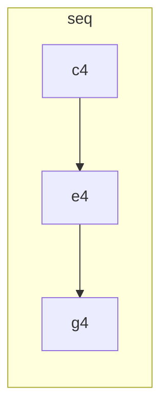
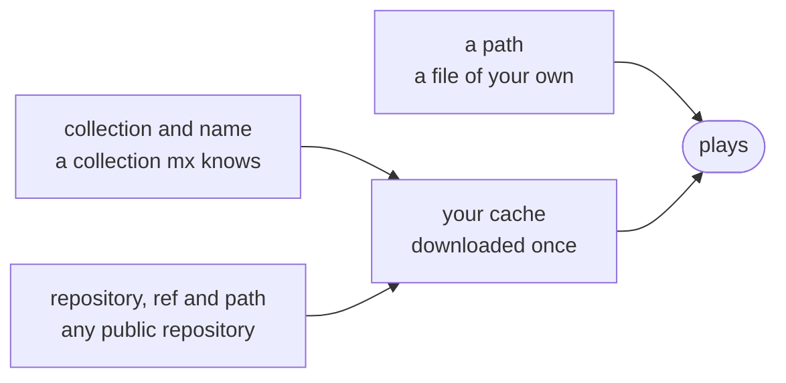
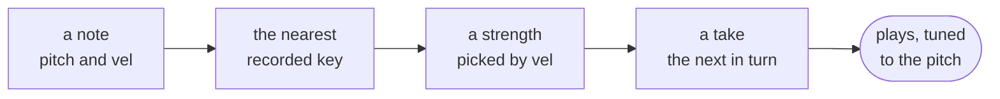
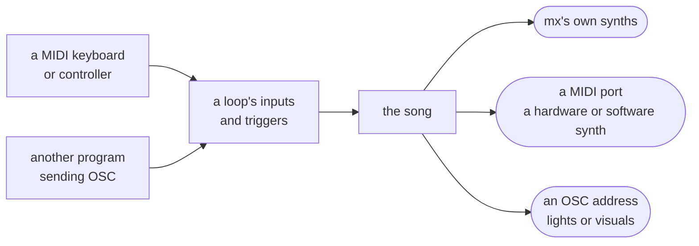

# The notation

A song is an Elixir file that starts with `import Mx` and ends with `song`.
Between the two, plain functions build the music: each returns a value, and `song` plays the value it is given.

```elixir
import Mx

melody = seq(e4: 1, g4: 1, a4: 2, g4: 1, e4: 1, d4: 2)
bass = seq(a2: 4, e2: 4)

song(
  tempo: 90,
  music:
    together([
      part(:flute, melody, synth: :flute, fx: :reverb),
      part(:bass, bass, synth: :double_bass)
    ])
)
```

`mx play song.exs` plays the file.
`mx print song.exs` prints each part's notes with their beats instead of playing them.

This page is the reference: it describes every function a song is written with, each with what it takes and what it refuses.
[From a note to a song](first_song.md) is the short way in, building one song in eight steps, and [the cheatsheet](cheatsheet.cheatmd) shows everything on one page.

The sections go from one note to a whole song, and then to what a song does beyond its notes:

| To | Read | Which describes |
|---|---|---|
| write notes and chords | [Notes](#notes) | `note`, `rest`, `chord` |
| put music together | [One after another, and at once](#one-after-another-and-at-once) | `seq`, `together`, `repeat`, `transpose`, `delay`, `each`, `beats` |
| give music to a player | [Parts](#parts) | `part`, with `synth:`, `fx:` and `defaults:` |
| share an effect between parts | [Buses](#buses) | `buses:`, `bus`, and a part's `send:` |
| write a drum's rhythm | [Rhythm](#rhythm) | `steps`, `hit`, `at`, `swing`, `feel` |
| write music as text | [Patterns](#patterns) | `~MX`, and the options of `steps` |
| lay out a whole song | [The song](#the-song) | `song`, sections, `form`, `only`, `without`, `tempo` |
| write a longer song | [A song as a module](#a-song-as-a-module) | `use Mx.Song`, declared parts, `kit` |
| vary music as it plays | [Loops](#loops) | `loop`, its inputs, playing live |
| play recordings | [Recordings](#recordings) | `sample`, `sampled`, the collections |
| reach other programs and devices | [MIDI and OSC](#midi-and-osc) | `midi`, `midi_cc`, `osc` |
| let one part lead the others | [Shared values](#shared-values) | `set` |
| change a sound that is playing | [Changing a sound while it plays](#changing-a-sound-while-it-plays) | `change`, `changes:`, `slur` |
| play a microphone through effects | [Live audio](#live-audio) | `live_audio:` |
| work out pitches and make choices | [Helpers](#helpers) | `pitch`, `scale`, `chord_at`, `nearest`, `voice`, `pick` and others |

## A little music first

Skip this section if you read music.

A note has a pitch and a length.

- The pitch is how high the note sounds, and it has a name: a letter from A to G and the number of its octave. C4 is the C in the middle of a piano.
- An octave is the distance from one C to the next C above it. C5 sounds like C4, only higher.
- Between the letters are the sharps and flats, the black keys of a piano: F sharp is just above F, and B flat just below B.
- Every pitch also has a number, which goes up by one for each key of the piano, black or white. C4 is 60, so the D above it is 62 and C5 is 72.

| Name | C4 | D4 | E4 | F4 | G4 | A4 | B4 | C5 |
|---|---|---|---|---|---|---|---|---|
| Number | 60 | 62 | 64 | 65 | 67 | 69 | 71 | 72 |

The length is counted in beats.

- A beat is the pulse you would tap your foot to.
- The tempo is how many beats pass in a minute. At 120 a beat lasts half a second, and at 60 a whole second.
- A length is a number of beats: 1 is one beat, 0.5 half of one, and 4 is four.

Several notes sounding at once are a chord, and a scale is the set of notes a tune is made from.

## Notes

`note` is one note: a pitch, and how many beats it lasts.
`rest` is silence for some beats.

```elixir
note(:a4, 1.5)
rest(1)
```

A pitch is a name or a number.

- A name is a letter from `a` to `g`, an optional `s` for sharp or `b` for flat, and an optional octave, which is 4 unless given.
- `:c4` is 60, `:fs3` is 54 and `:eb3` is 51.

Options after the length go to the synth that plays the note:

```elixir
note(:a4, 1.5, amp: 0.8, release: 2)
```

Each synth has its own options, which [Instruments](instruments.md) lists.
`attack`, `decay`, `sustain`, `release` and every option ending in `_slide` are measured in beats, so `release: 1` lasts one beat at any tempo.

### Chords

A list of pitches is a chord, and `chord` builds the list from its lowest note and its kind:

```elixir
note(chord(:c4, :major), 2)
note(chord(:e3, :minor), 1, strum: 0.05)
note([40, 47, 52, 56], 1, vel: [0.8, 0.6, 0.5, 0.45])
```

- `strum:` starts each note of the chord that many beats after the one below it. A negative strum goes from the highest note down.
- An option given as a list has one value for each note of the chord.

## One after another, and at once

Two functions put music together.
`seq` plays its items one after another.
`together` starts its items at once.




`seq` takes a list of music, or note names and lengths, where `r` is a rest:

```elixir
seq([note(:c4, 1), note(:e4, 1), note(:g4, 2)])
seq(c4: 1, e4: 1, g4: 2, r: 1)
```

`together` takes a list, and lasts as long as its longest item:

```elixir
together([seq(c5: 2, b4: 2), seq(e4: 4)])
```

Either takes a collection and a function instead, and plays the music the function returns for each item: a list, a range or any other enumerable.
What the function returns can be anything a list item can be, so a `{name, beats}` pair is a note:

```elixir
seq(1..72, &bar/1)
seq([:c4, :e4, :g4], fn name -> {name, 1} end)
together([:c4, :e4, :g4], fn name -> note(name, 2) end)
```

The two nest, so a song is built from small pieces with names:

```elixir
verse = seq(c4: 1, e4: 1, g4: 2)
chorus = together([seq(c5: 2, b4: 2), seq(e4: 4)])

seq([verse, transpose(verse, 5), repeat(chorus, 2)])
```

- `repeat(music, 4)` plays the music four times. `repeat(music)` plays it until mx stops, and can only hold the whole of a song's music.
- `transpose(music, 12)` moves every note an octave up.
- `delay(music, 7)` is the music after 7 beats of silence, so inside `together` it starts 7 beats after the rest.
- `beats(music)` is the length of music in beats.

`each` gives options to every note and hit of some music, where a note gives none of its own:

```elixir
each(seq(e5: 0.5, a5: 0.5, c6: 1), vel: 0.8)
each(music, fn beat -> [vel: if(beat == 0, do: 0.9, else: 0.6)] end)
```

- Given a function, `each` calls it with the beat each note starts on, counted from the start of the music, and gives the note the options it returns.
- The notes a loop returns take the options too, each pass counted from its own start.
- Samples, MIDI notes, messages and changes are left as they are.
- An option the part's synth does not take is refused.

## Parts

A `part` is music played by one player.
It has a name, its music, the synth that plays it, and the effects its sound goes through.


```elixir
part(:soprano, melody, synth: :oboe)
```

- The synth is `:tri`, a plain triangle wave, unless given. [Instruments](instruments.md) lists the others.
- A part of one name is the same player wherever it appears in the song, so it must have the same options each time.

`fx:` sends the part through an effect, or through a list of effects in order, each with its options:

```elixir
part(:keys, music, synth: :piano, fx: :reverb)
part(:keys, music, synth: :piano, fx: [echo: [phase: 0.75], reverb: [decay_seconds: 3.2]])
```

`defaults:` gives every note of the part options it takes unless the note gives its own:

```elixir
part(:guitar, music, synth: :guitar, defaults: [amp: 0.55])
```

## Buses

A bus is a chain of effects that parts share: each part sends a share of its sound into it, and the effect runs once.
The song declares its buses by name, and a part's `send:` gives the level it sends at into each:

```elixir
drums = part(:tom, toms, synth: :mid_tom, send: [room: 0.2])
keys = part(:keys, chords, synth: :organ, send: [room: 0.4, tape: 0.1])

song(
  tempo: 74,
  buses: [
    room: [reverb: [decay_seconds: 2.3]],
    tape: [fx: [echo: [phase: 0.75, decay: 4]], send: [room: 0.3]]
  ],
  music: together([drums, keys])
)
```

- A send's level is a plain factor, as `amp` is, and it takes the part's sound after the part's own effects.
- The part's own sound still plays as it would without the send: the bus adds to it.
- In a bus an effect's `mix` is 1 unless given, so the bus plays only the effect's sound.
- A bus given with `fx:` and `send:` sends into other buses in turn, here the echoes of `tape` into `room`.
- A song module declares each bus beside its parts, as `bus :room, fx: [reverb: [decay_seconds: 2.3]]` and `bus :tape, fx: [echo: [phase: 0.75]], send: [room: 0.3]`.
- A bus and a part cannot have the same name, a send into a bus the song does not declare is refused, and so is a bus that sends into itself, directly or through others.
- A muted part sends nothing, and `--mute` and `--solo` name parts, not buses.

`change` moves a send while the song plays, at once or over `send_slide:` beats.
A dub throw sends one hit into the echo and pulls the part back out, so only that hit repeats:

```elixir
hits = seq([note(:a2, 1), note(:a2, 1), note(:a2, 1), note(:a2, 1)])
throw = at([{1.9, change(:tom, send: [tape: 1])}, {2.9, change(:tom, send: [tape: 0])}], 4)
part(:tom, together([hits, throw]), synth: :mid_tom)
```

- `change(:tom, send: [tape: 0], send_slide: 2)` fades the part out of the echo over two beats.
- `change({:room, :reverb}, decay_seconds: 5.1)` changes an effect of a bus, as it changes an effect of a part.
- `mx print` lists each bus with its effects and what sends to it, and `--ring-out` waits for the buses to fade.

## Rhythm

A drum plays hits, not notes: it has its own pitch.
`steps` writes a rhythm as text, one character for each step.

```elixir
part(:kick, steps("x... x... x... x.x.", 0.25), synth: :kick)
```

Each character lasts a quarter of a beat here, so sixteen of them are four beats:

```
beat   1    2    3    4
       x... x... x... x.x.
```

- An `x` is a hit, a dot is silence, and spaces are left out.
- A digit is a hit at that level, 9 the loudest: `"9..5 9.7."`.

Hits can also be placed by their beat:

```elixir
part(:cajon, at([{0, hit(slap: 1, vel: 0.8)}, {1.5, hit(vel: 0.5)}], 2), synth: :cajon)
```

- `hit(vel: 0.5)` is one hit of a drum at its own pitch, taking no time.
- `at([{0.5, music}, {1.5, music}], 2)` is music of 2 beats that starts each item at its beat, so hits at known beats need no rests between them.
- `at([{0, 0.4}, {1.5, 0.8}], 2, fn vel -> hit(vel: vel) end)` takes a value at each beat instead of music, and places there the music the function returns for it.

### Feel

How a groove is played, which steps come late and which are louder, is written apart from its notes.
`feel` takes it as tables, a number to each step of `step:` beats, counted from the start of the music:

```elixir
feel(music, step: 0.25, push: [0, 0.035, 0, 0.035], lean: [1, 0.7, 0.85, 0.7])
```

- A note on a step comes later by its number in `push:`, or earlier by a number below 0.
- Its vel, its own or else its part's, is multiplied by its number in `lean:`, kept from 0 to 1.
- The tables go round, each on its own length, so four numbers with a step of 0.25 cover a beat. A note between two steps is left as it is.
- `loose: 0.01` moves every start by a random amount of at most that many beats either way, and `touch: 0.1` multiplies every vel by a random number from 0.9 to 1.1, the same on every load.
- No note starts before the music does, the music lasts as long as before, and `feel` cannot hold a loop.

`swing(music, fun)` is the general form: it starts each note at the beat the function returns for the beat it was written on, so some notes can be pushed late and others early.

## Patterns

A pattern is music written as text, and `steps(pattern, step)` plays it, each step of the pattern lasting `step` beats.
`~MX` writes a pattern, and reads it when the song compiles, so a bracket left open or a length that is no number is refused with its line before anything plays.

```elixir
steps(~MX"g4:2 _ g4 bb4:2 _ a4 | g4:4 - -", 0.25, vel: 0.8)
steps(~MX"9... 9... 9..5 9.7."s, 0.25)
```

### A word to a step

Without a modifier, `~MX` reads a word to a step.

| Written | Plays |
|---|---|
| `g4`, `fs5` | that note |
| `_` | silence |
| `-` | the word before it, one step longer |
| `g4:2`, `g4:1.5` | the note for two steps, or one and a half |
| `g5/b4` | both notes together |
| `[f f]` | two notes in the time of one step |
| `eb2:2 ~g2:2` | one note of four steps that glides to G halfway |
| `g4:1/3`, `_:3/2` | the note for a third of a step, or silence for a step and a half |
| `>h`, `>g4` | the word accented, as `accent:` says |
| `b5 ^d6 c6` | a grace note: D6 just before C6, taking no step |

A bar line, `|`, is only for reading.

Glides and lengths:

- A word after `~` is not struck: the note before it glides to that pitch and lasts through it.
- Three lengths of `1/3` fill a step exactly, where three of `0.333` do not.

Accents:

- An accent is what `steps` is given as `accent:`. A number is added to the sound's vel, up to 1, and a list of options takes the place of the sound's options of the same names.
- `steps(~MX"f >f f f", 0.25, strokes: [f: [vel: 0.5]], accent: 0.3)` plays the second stroke at vel 0.8.
- An accented word in a pattern played without `accent:` is refused, and so is an accent on a silence, a hold or a word that glides.

Grace notes:

- A grace note starts `grace:` beats before the word after it, 0.06 unless `steps` is given another, and lasts until that word starts. The words around it start and last as they would without it.
- Two grace notes in a row play in order, the first two lengths early.
- A drummer's flam is a soft stroke as a grace note before a hard one: `steps(~MX"_ ^s S", 0.25, strokes: [s: [vel: 0.3], S: [vel: 0.9]])`.
- A grace note before a silence, a hold or a word that glides, one with a length, one that ends a pattern, and one that would start before the pattern does, are refused.

### A character to a step

With the modifier `s`, as in `~MX"9..5 x..."s`, it reads a character to a step: a dot is silence, and spaces and bar lines are left out.
A plain string given to `steps` is read the same way.

### What the words sound like

A pattern says nothing of what its words sound like; the options of `steps` do:

```elixir
steps(~MX"9...9..5"s, 0.25, sample: "kick.wav", release: 0.1)
steps(~MX"ccoc ccoc"s, 0.25, strokes: [o: [vel: 0.75, sustain: 0.2], c: [vel: 0.5]])
steps(~MX"..1. .5.3"s, 0.25, notes: [:g4, :a4, :bb4, :c5, :d5])
steps(~MX"S R g:2 ~M:2 P", 0.5, words: [S: :d4, R: :e4, g: :f4, M: :g4, P: :a4])
steps(~MX"x.xx"s, 0.25, each: fn step -> [vel: if(step == 0, do: 0.9, else: 0.5)] end)
steps(~MX"eb2:2 ~g2:2 d2:4", 0.25, slide: 0.3)
```

- `x` is a hit of a drum at its own pitch.
- A digit is a hit at that level, 9 the loudest. It sets `vel:`, or the option `digit:` names.
- `sample:` plays each hit as that sample, where a digit sets `amp:`.
- `strokes:` gives the options of other characters or words, so a drum's strokes can have their own letters.
- `notes:` makes a digit a hit tuned to that note of the list, counted from 1.
- `words:` gives words their pitches, a note's name, a number or a list of them for a chord, so a tradition that names its pitches otherwise can write them. Such a word is a note in every way: it takes a length, joins others with a slash, glides, and takes an accent and a grace note. A word with marks of its own is written as a quoted name, as in `words: ["S'": :d5, ".n": :cs4]`. A word is looked up in `strokes:` first, then in `words:`, and is a note's name otherwise, and `words:` goes only with a pattern read a word to a step.
- `each:` is a function of the step a sound starts on, counted from 0, that returns more options for it. A function of two takes the sound's length in steps as well.
- `slide:` is how many beats a glide takes.
- Any other option goes to every sound.

### Joining patterns

A pattern is a list, so two patterns join with `++`, and `steps` plays a list of patterns as one bar after another:

```elixir
kick = [~MX"9...9...9..59.7."s, ~MX"9..59...9..59.7."s]
part(:kick, repeat(steps(kick, 0.25), 4), synth: :kick)
```

A sigil takes no interpolation; build a longer pattern by joining shorter ones.

## The song

`song` is the last line of the file: a tempo and the music.

```elixir
song(tempo: 72, music: music)
```

The tempo is 60 beats a minute unless given.

`meter:` says how many beats make a bar, a whole number, 4 unless given:

```elixir
song(tempo: 90, meter: 3, music: waltz)
```

mx gives the meter with the song's page data, for a program that draws the song in bars, and `mx export` writes it as the score's time signature, 3/4 for `meter: 3`, unless `--time` gives another.
It does not change what plays.

`key:` says the key the song is in, spelled as `mx export --key` spells it, the tonic's letter, `s` for sharp or `b` for flat, then `m` for minor:

```elixir
song(tempo: 104, key: :em, music: music)
```

`:em` is E minor, `:bb` B♭ major and `:fsm` F♯ minor; a module song states it with its tempo, as `use Mx.Song, tempo: 104, key: :g`.
A song that states no key is in none.
mx gives the key with the song's page data, and `mx export` writes the score in it unless `--key` gives another.
A key mx does not know, such as `:h`, is refused when the song is read.
It does not change what plays.

### Sections

The items of the song's outermost `seq` are its sections, also when the `seq` is inside `repeat`.
A part plays only in the sections that hold it, so instruments can take turns.


```elixir
import Mx

melody = seq(c4: 1, e4: 1, g4: 2)
answer = seq(r: 2, g5: 1, e5: 1)

first = together([part(:trombone, melody, synth: :trombone), part(:flute, answer, synth: :flute)])
second = together([part(:cello, melody, synth: :cello), part(:tenor_sax, answer, synth: :tenor_sax)])

song(tempo: 72, music: repeat(seq([first, second])))
```

- When you save the file while the song plays, the new version takes over at the end of the current section.
- A song whose music is not a `seq` is one section.

`form` writes the order of the sections and how many times each plays, and makes each section's music with a function:

```elixir
def song do
  repeat(form([a: 2, b: 2, a: 1], &strain/2, round: true))
end

defp strain(section, %{coming: coming}), do: together(melody: melody(section), bass: bass(section, coming))
```

- `form([a: 2, b: 1], fun)` plays a, a and b, each a section; `form([:a, :b], fun)` plays each once.
- A function of one argument takes the section's name.
- A function of two also takes a map: `pass` counts the sections played before this one, from 0, `time` counts the times a section of this name played before, from 0, and `coming` is the name of the section that follows, nil for the last.
- `round: true` gives the last section the first one's name as `coming`, for a form that repeats.
- A count below 1, and a name that is not an atom, are refused.

`without` and `only` leave parts out of some music, so a section can say who sits out instead of each part saying where it rests:

```elixir
@silent [intro: [:bass, :congas], mambo: [:cascara], solo: []]

defp section(section) do
  without(band(), @silent[section])
end
```

- `without(music, :cascara)` is the music with that part left out, and `without(music, [:kick, :bass])` with both; `only(music, [:kick, :bass])` leaves out every other part.
- A part left out plays nothing in that music, and is silent for as long as it would have played, so the music lasts as long and every other part plays as before.
- A tempo change written in a part left out stays, and a part that plays a loop is left out with its loop.
- A name that no part of the music has is refused.

### Changing the tempo

`tempo(140)` changes the tempo for every part from the beat where it is written, and takes no time.
`tempo(130, over: 16)` gets there evenly over 16 beats.

In music that repeats, give the first section its tempo too, since each change comes round again:

```elixir
repeat(seq([tempo(100), verse, tempo(140), chorus]))
```

### What mx refuses

A function refuses what cannot play, such as an unknown note name or an option the synth does not have.
mx prints the refusal with the line of the song file, and a song that is already playing keeps its previous version.

`fx:` sends the whole song through effects, written as a part's `fx:`:

```elixir
song(tempo: 104, fx: [limiter: [ceiling: -1]], music: music)
```

- Every part, and live audio, plays through them after its own effects, its gain, and mute and solo.
- A song has none unless it gives them, and no limiter: a song that is too loud still clips, and mx says so.
- `limiter` holds every peak under its `ceiling`, in dB below full scale, and delays the song by 5 ms to do it; [Effects](instruments.md#effects) lists what each effect takes.
- `change({:song, :limiter}, ceiling: -3)` changes one of them, from any part or beside the parts.
- A module song gives them with its tempo, as `use Mx.Song, tempo: 104, fx: [limiter: []]`.
- No part can be named `song`, the name a change gives the song's effects.

## A song as a module

A longer song reads better as a module that uses `Mx.Song` in place of ending with `song`.
Its parts are declared once, with their synths and effects, and its music is plain functions:

```elixir
defmodule Paredao do
  use Mx.Song, tempo: 92

  part :kick, synth: :kick, fx: [level: [amp: 0.6]]
  part :bass, synth: :double_bass, defaults: [amp: 0.5]

  def song, do: seq([intro(), beat(), beat()])

  defp intro, do: part(:kick, kick(2))

  defp beat do
    together(
      kick: kick(4),
      bass: steps(~MX"g1:3 _ g1:3 _ bb1:3 _ d2:2 f2:2", 0.25)
    )
  end

  defp kick(bars), do: repeat(steps(~MX"9...9...9..59.7."s, 0.25), bars)
end
```

- `use Mx.Song` imports `Mx`, and takes the options of `song` except `music:`.
- `song/0` returns the song's music, and mx calls it when it loads the file.
- `part :kick, synth: :kick` in the module's body declares a part with its options, once.
- `part(:kick, music)` in a function is that part playing the music, with the options it was declared with.
- `together(kick: music, bass: music)` in a function plays each declared part by its name, as `together([part(:kick, music), part(:bass, music)])` does; the list can be built while the song loads, and an entry whose value is a number is still a note.

A part that is not declared, and a part declared twice, do not compile, and mx names the line; a name `together` is given that no part declares is refused when the song loads.
A song that ends with `song` declares no parts, so its `together` takes no part names.
A file holds one such module; a module that uses `Mx.Instrument` can stand beside it.
`examples/funk_br.exs` is a whole song written this way.

`mix format` keeps a declaration without parentheses when the project's `.formatter.exs` has `import_deps: [:mx]`.

### Kits

A hand drum is one instrument to its player and several parts to mx: a pandeiro is a thumb, a heel, the jingles and a slap, each its own synth.
`kit` in the module's body declares its strokes, each with the declared part that plays it and its options, and `kit` in a function plays one pattern on all of them:

```elixir
part :pandeiro_thumb, synth: :pandeiro_thumb
part :pandeiro_heel, synth: :pandeiro_heel
part :pandeiro_jingles, synth: :pandeiro_jingles

kit :pandeiro,
  o: [part: :pandeiro_thumb, vel: 0.75],
  h: [part: :pandeiro_heel, vel: 0.55],
  f: [part: :pandeiro_jingles, vel: 0.5],
  of: [:o, :f]

def song, do: repeat(kit(:pandeiro, ~MX"o f >h f  of f h f", 0.25, accent: [vel: 0.9]))
```

- `kit(:pandeiro, pattern, step)` is the pattern played by the kit's parts, each playing the strokes that name it at the beats `steps` gives them, and silent where the pattern has none of its strokes.
- A stroke given as a list of other strokes plays them together, as `of: [:o, :f]` does.
- The pattern is read a word to a step or a character to a step, and a fourth argument takes `each:`, `accent:` and `grace:` as `steps` does; any other option goes to every stroke.
- Every word is a stroke of the kit, so `f` is the kit's stroke and never F4, and a word the kit has not is refused.
- What a kit plays holds parts, so it goes beside other parts in `together`, not inside a part.
- Each part keeps its own name, synth, defaults and effects, so `mx print`, `--mute` and `--solo` name the parts as before.
- A kit that names a part not declared, a kit declared twice, and a stroke that names a stroke the kit does not have, do not compile.

## Loops

A `loop` works its music out again on every pass, so a part can vary from pass to pass.
`loop(4, fn pass, inputs -> music end)` runs the function every 4 beats and plays the music it returns.


```elixir
import Mx

drums =
  loop(16, fn pass, _ ->
    last_bar = if rem(pass, 4) == 3, do: "x.x.xxxx", else: "x...x..."
    steps("x...x... x...x... x...x... " <> last_bar, 0.5)
  end)

song(tempo: 96, music: together([
  part(:bass, repeat(seq(c2: 4, g2: 4), 8), synth: :saw),
  part(:drums, drums, synth: :kick)
]))
```

- `pass` counts the passes the loop has played, from 0, and `ring(list, pass)` steps through a list one item per pass.
- Beside other music a loop plays until the longest of the rest ends. Alone, or beside only loops, it plays until mx stops, unless `times: 4` gives its number of passes.
- Music shorter than the loop is followed by silence until the next pass, and music longer than the loop is refused.
- A pass that raises prints its error, and the loop plays its next pass.
- `mx print song.exs --pass 4` prints the fifth pass.

### Inputs

`inputs` holds what has arrived from outside.

| Field | Holds |
|---|---|
| `inputs.cc` | the latest value of each MIDI controller |
| `inputs.notes` | the velocity of the latest note on for each note |
| `inputs.osc` | the arguments of the latest message to each OSC address |
| `inputs.values` | each shared value |

An entry is nil until something has sent it.

```elixir
part(:bass, loop(1, fn _, inputs -> note(:c2, 1, cutoff: (inputs.cc[74] || 64) * 50) end), synth: :saw)
```

mx works a pass out half a second before it plays, so an input that changes shows from the next pass on.

### Playing live

A loop can also play a pass each time something arrives, as soon as possible:

```elixir
loop(fn trigger, _ -> note(trigger.note, 1) end, on: :midi_note)
```

- `on: :midi_note` waits for notes, `on: :midi_cc` for controller changes, and `on: {:osc, "/hit"}` for messages to that address.
- `trigger` is what arrived: `%{note: 60, velocity: 100}`, `%{number: 74, value: 64}`, or `%{address: "/hit", args: [1]}`.
- `grid: 4` starts the pass on the next beat of the song that is a multiple of 4, the next bar of four, and `grid: 1` on the next beat; an input less than 20 ms after such a beat starts it on that beat, a little late. Another input while the pass waits for its beat starts nothing more.

## Recordings

A song plays recordings as well as synths, in two ways.
`sample` plays one recording, as it is or cut up.
`sampled` makes an instrument out of many recordings of one, and a part plays it like a synth.

### Naming a recording

There are three ways to name a recording, and they work in both `sample` and `sampled`.



```elixir
sample("kick.wav", 1)
sample({:sonic_pi, :bd_haus}, 1)
sample({:vcsl, "Idiophones/Struck Idiophones/Agogo Bells/Agogo_High_v1_rr1_Mid.wav"}, 1)
sample({:github, "owner/repo", "main", "drums/kick.wav"}, 1)
```

- A string is the path of a WAV, AIFF or FLAC file. A path that does not start at the root is read from the folder mx runs in.
- `{collection, name}` is a recording of a collection mx knows by name, which [Collections](#collections) lists.
- `{:github, repo, ref, path}` is a file of any public GitHub repository, at a commit, tag or branch.

mx downloads a recording into your cache when the song loads, and plays it from the cache after that.

### Samples

`sample` plays one recording at its beat.

```elixir
sample({:sonic_pi, :bd_haus}, 1)
```

- The length, 1 here, is how long the music waits before what comes next.
- The recording itself plays to its end, as a cymbal rings on after it is struck.
- A part that plays only samples needs no `synth:`.

Options cut a recording up and fit it to the beat.
This song plays a drum break whole for a bar, then eight pieces of it in a new order:

```elixir
import Mx

amen = {:sonic_pi, :loop_amen}
piece = fn number -> sample(amen, 0.5, slices: 8, slice: number, beats: 0.5) end

whole = sample(amen, 4, beats: 4)
chopped = seq([0, 1, 2, 3, 0, 0, 6, 7], piece)

song(tempo: 136, music: repeat(part(:drums, seq([whole, chopped]))))
```

```
the recording, slices: 8    0   1   2   3   4   5   6   7
the second bar plays        0   1   2   3   0   0   6   7
```

| Option | What it does |
|---|---|
| `rate: 0.5` | plays at half speed, an octave lower. A negative rate plays backwards. |
| `beats: 4` | plays faster or slower so the sample lasts 4 beats at the tempo, in place of `rate` |
| `from: 0.5, to: 1.0` | plays only from 0.5 to 1 second into the file |
| `start: 0.25, finish: 0.5` | the same kind of cut, as positions from 0 to 1 |
| `slices: 8, slice: 3` | plays the fourth of eight equal pieces, counted from 0 |
| `normalize: true` | scales the sample so its loudest moment reaches full scale before `amp`, for files recorded at very different levels |
| `amp`, `pan` | how loud, and where from left to right |
| `attack`, `decay`, `sustain`, `release` | the envelope, in beats |

A cut outside the file is refused when the song loads, with its line.

### Sampled instruments

Some instruments are recorded one key at a time, often at several strengths and in several takes.
`sampled(folder)` makes an instrument from a folder of recordings, one file for each key, and a part plays it with `note` and `hit` as it plays a synth:

```elixir
import Mx

mbira =
  sampled({:vcsl, "Idiophones/Plucked Idiophones/Mbira dzaVadzimu Nyamaropa, Zimbabwe, Low B"})

tune = seq([note(:e4, 1), note(:fs4, 1, vel: 0.4), note(chord(:e3, :major), 2, strum: 0.05)])

song(tempo: 100, music: repeat(part(:mbira, tune, synth: mbira)))
```

For each note, mx chooses one file and tunes it:



- A note plays the recorded key nearest to it, sped up or slowed down to its pitch.
- `vel` from 0 to 1 picks among the recorded strengths, the softest at 0 and the hardest at 1.
- Repeated notes play the takes in turn, so two notes in a row are not the same recording.
- A note also takes `amp`, `pan` and the envelope options.

mx reads what each file is from its name, as the VCSL library names its files:

| In the name | Read as | Example |
|---|---|---|
| `E4`, `C#3`, `Bb2` | the note | `MBira4_pluck_Main_E4_19_50_100_rr2.wav` is E4 |
| `v5` or `vl3` | the strength | `BDrumNew_hit_v5_rr1_Sum.wav` is strength 5 |
| `rr2` | the take | both files above name their take |

For files named another way, list them with what each one is:

```elixir
sampled([{"low.wav", note: :c2}, {"high.wav", note: :c3, strength: 2, take: 1}])
sampled([{{:salamander, "Samples/C4v8.flac"}, note: :c4}])
```

A drum has strengths and takes but no notes, and plays with `hit` or a pattern:

```elixir
kick = sampled([{"kick_soft.wav", strength: 1}, {"kick_hard.wav", strength: 2}])
part(:kick, steps("x.x.", 1), synth: kick)
```

Listing is also the fix for a folder whose names give the wrong note.
`examples/sample_packs/vcsl_lamellophones.exs` lists its files an octave above their names, which is where those recordings sound.

### Collections

A collection is a set of recordings mx knows by name, so a song names a recording without saying where it is kept.

```elixir
sample({:sonic_pi, :loop_amen}, 4)
sample({:vcsl, "Idiophones/Struck Idiophones/Agogo Bells/Agogo_High_v1_rr1_Mid.wav"}, 1)
sampled({:vcsl, "Idiophones/Plucked Idiophones/Kalimba, Kenya"})
```

**Sonic Pi's pack** is `:sonic_pi`, 206 samples under Creative Commons 0.

- Its samples are named by atoms: `{:sonic_pi, :loop_amen}`.
- The names are the names of the files in [Sonic Pi's samples folder](https://github.com/sonic-pi-net/sonic-pi/tree/v5.0.0/etc/samples), without the extension.
- It is downloaded whole, once, before a song can play it:

```sh
mx samples download sonic_pi
```

**Every other collection** is a public GitHub repository.

- Its files and folders are named by their path in the repository: `{:vcsl, "Idiophones/..."}`.
- It is pinned to one commit, so a song sounds the same each time.
- Each repository states its own license.
- The third column names a song that plays it.

| Collection | Repository | Played in |
|---|---|---|
| `:freepats_button_accordion` | [freepats/button-accordion-HN](https://github.com/freepats/button-accordion-HN) | `examples/sample_packs/freepats_acoustic.exs` |
| `:freepats_electric_guitar` | [freepats/electric-guitar-FSBS-clean](https://github.com/freepats/electric-guitar-FSBS-clean) | `examples/sample_packs/freepats_electric.exs` |
| `:freepats_fm_piano` | [freepats/fm-piano1](https://github.com/freepats/fm-piano1) | `examples/sample_packs/freepats_electric.exs` |
| `:freepats_lately_bass` | [freepats/lately-bass](https://github.com/freepats/lately-bass) | `examples/sample_packs/freepats_electric.exs` |
| `:freepats_spanish_guitar` | [freepats/spanish-classical-guitar](https://github.com/freepats/spanish-classical-guitar) | `examples/sample_packs/freepats_acoustic.exs` |
| `:freepats_synth_brass` | [freepats/synth-brass-1](https://github.com/freepats/synth-brass-1) | `examples/sample_packs/freepats_electric.exs` |
| `:freepats_synth_choir` | [freepats/synth-pad-choir](https://github.com/freepats/synth-pad-choir) | `examples/sample_packs/freepats_electric.exs` |
| `:freepats_synth_percussion` | [freepats/synthesizer-percussion](https://github.com/freepats/synthesizer-percussion) | `examples/sample_packs/freepats_electric.exs` |
| `:freepats_synth_square` | [freepats/synth-square](https://github.com/freepats/synth-square) | `examples/sample_packs/freepats_electric.exs` |
| `:freepats_synth_strings` | [freepats/synth-strings-1](https://github.com/freepats/synth-strings-1) | `examples/sample_packs/freepats_electric.exs` |
| `:freepats_upright_piano` | [freepats/upright-piano-KW](https://github.com/freepats/upright-piano-KW) | `examples/sample_packs/freepats_acoustic.exs` |
| `:karoryfer_big_rusty_drums` | [sfzinstruments/karoryfer.big-rusty-drums](https://github.com/sfzinstruments/karoryfer.big-rusty-drums) | `examples/sample_packs/karoryfer_surf.exs` |
| `:karoryfer_bigcat_cello` | [sfzinstruments/karoryfer-bigcat.cello](https://github.com/sfzinstruments/karoryfer-bigcat.cello) | `examples/sample_packs/karoryfer_ballad.exs` |
| `:karoryfer_black_and_green_guitars` | [sfzinstruments/karoryfer.black-and-green-guitars](https://github.com/sfzinstruments/karoryfer.black-and-green-guitars) | `examples/sample_packs/karoryfer_surf.exs` |
| `:karoryfer_caveman_cosmonaut` | [sfzinstruments/karoryfer.caveman-cosmonaut](https://github.com/sfzinstruments/karoryfer.caveman-cosmonaut) | `examples/sample_packs/karoryfer_cumbia.exs` |
| `:karoryfer_gogodze_phu` | [sfzinstruments/karoryfer.gogodze-phu-vol-i](https://github.com/sfzinstruments/karoryfer.gogodze-phu-vol-i) | `examples/sample_packs/karoryfer_polka.exs` |
| `:karoryfer_growly_bass` | [sfzinstruments/karoryfer.growlybass](https://github.com/sfzinstruments/karoryfer.growlybass) | `examples/sample_packs/karoryfer_surf.exs` |
| `:karoryfer_horse_pulse` | [sfzinstruments/Karoryfer.HorsePulse](https://github.com/sfzinstruments/Karoryfer.HorsePulse) | `examples/sample_packs/karoryfer_polka.exs` |
| `:karoryfer_merry_orks` | [sfzinstruments/karoryfer.272-merry-orks](https://github.com/sfzinstruments/karoryfer.272-merry-orks) | `examples/sample_packs/karoryfer_polka.exs` |
| `:karoryfer_shiny_guitar` | [sfzinstruments/karoryfer.shinyguitar](https://github.com/sfzinstruments/karoryfer.shinyguitar) | `examples/sample_packs/karoryfer_ballad.exs` |
| `:karoryfer_sneaky_bass` | [sfzinstruments/karoryfer.sneakybass](https://github.com/sfzinstruments/karoryfer.sneakybass) | `examples/sample_packs/karoryfer_ballad.exs` |
| `:karoryfer_squid_pipes` | [sfzinstruments/karoryfer.squidpipes](https://github.com/sfzinstruments/karoryfer.squidpipes) | `examples/sample_packs/karoryfer_polka.exs` |
| `:karoryfer_swag_bass` | [sfzinstruments/karoryfer.swagbass](https://github.com/sfzinstruments/karoryfer.swagbass) | `examples/sample_packs/karoryfer_cumbia.exs` |
| `:karoryfer_swirly_drums` | [sfzinstruments/karoryfer.swirly-drums](https://github.com/sfzinstruments/karoryfer.swirly-drums) | `examples/sample_packs/karoryfer_cumbia.exs` |
| `:karoryfer_unruly_drums` | [sfzinstruments/karoryfer.unruly-drums](https://github.com/sfzinstruments/karoryfer.unruly-drums) | `examples/sample_packs/karoryfer_polka.exs` |
| `:karoryfer_war_tuba` | [sfzinstruments/karoryfer.war-tuba](https://github.com/sfzinstruments/karoryfer.war-tuba) | `examples/sample_packs/karoryfer_polka.exs` |
| `:karoryfer_weresax` | [sfzinstruments/karoryfer.weresax](https://github.com/sfzinstruments/karoryfer.weresax) | `examples/sample_packs/karoryfer_ballad.exs` |
| `:mridangam` | [yaxu/mrid](https://github.com/yaxu/mrid) | `examples/sample_packs/mridangam.exs` |
| `:salamander` | [sfzinstruments/SalamanderGrandPiano](https://github.com/sfzinstruments/SalamanderGrandPiano) | `examples/sample_packs/salamander.exs` |
| `:vcsl` | [sgossner/VCSL](https://github.com/sgossner/VCSL) | `examples/sample_packs/vcsl.exs` |
| `:virtuosity_drums` | [sfzinstruments/virtuosity_drums](https://github.com/sfzinstruments/virtuosity_drums) | `examples/sample_packs/virtuosity.exs` |
| `:vsco` | [sgossner/VSCO-2-CE](https://github.com/sgossner/VSCO-2-CE) | `examples/vassourinhas_samples.exs` |

A song downloads the files it names as it loads.
`mx samples download` fetches a whole collection, or one folder of it, ahead of time:

```sh
mx samples download vcsl
mx samples download "vcsl:Idiophones/Struck Idiophones/Agogo Bells"
mx samples download "owner/repo@main:drums"
```

Running it again finishes an interrupted download.

## MIDI and OSC

MIDI and OSC are two ways for music programs and devices to send each other messages.
MIDI carries notes and controller changes, to and from keyboards and synths.
OSC, Open Sound Control, carries any message to a network address, to and from other programs.

A song works with both in two directions.



What comes in reaches a loop, as [Inputs](#inputs) and [Playing live](#playing-live) describe.
What goes out is written in the music, like notes:

```elixir
import Mx

keys =
  loop(fn trigger, _ -> note(trigger.note, 1, vel: trigger.velocity / 127) end, on: :midi_note)

bass_line = repeat(seq([midi(:c3, 1), midi(:g3, 1, velocity: 70)]), 16)
flashes = repeat(seq([osc("/flash", [1]), rest(4)]), 8)

song(
  tempo: 120,
  osc_to: {"127.0.0.1", 9000},
  osc_from: 9001,
  music:
    together([
      part(:keys, keys, synth: :piano),
      part(:synth, bass_line, midi: "IAC Driver Bus 1"),
      part(:lights, flashes)
    ])
)
```

The keyboard plays mx's piano, a synth outside mx plays the bass line, and another program gets a message every four beats.

| Function | Sends | Takes |
|---|---|---|
| `midi(:c3, 1)` | a note on and, a beat later, its note off | `velocity`, 100 unless given, and `channel`, 1 unless given |
| `midi_cc(74, 64)` | a controller change, taking no time | `channel` |
| `osc("/flash", [1, "a"])` | a message with numbers and strings as its arguments, taking no time | |

- A part's `midi:` names the output port its MIDI goes to. Without it, MIDI goes to every connected port.
- The song's `osc_to:` names the host and port OSC goes to.
- The song's `osc_from:` names the port mx listens on, for a loop's `inputs.osc` and `on: {:osc, address}`.
- A render sends no MIDI or OSC and has no input, so it leaves those parts out and names them.

## Shared values

`set` shares a value with every loop, so one part can lead the others.
Here a conductor names a new root every 8 beats, and the bass follows it:

```elixir
import Mx

roots = [:c2, :f2, :g2, :c2]
conductor = loop(8, fn pass, _ -> seq([set(:root, ring(roots, pass)), rest(8)]) end)

bass =
  loop(2, fn _, inputs ->
    root = pitch(inputs.values[:root] || :c2)
    seq([note(root, 1), note(root + 7, 1)])
  end)

song(tempo: 100, music: together([part(:conductor, conductor), part(:bass, bass, synth: :saw)]))
```

- `set(:root, :f2)` takes no time, and a loop reads the value as `inputs.values[:root]`.
- A value is nil until it is set, so the bass starts from `:c2`.
- A loop sees a new value from its next pass on. The conductor sets F at beat 8, and the bass, already playing its pass, moves to F at beat 10.

## Changing a sound while it plays

A note's options are fixed when it starts.
`change` reaches the sounds of a part that are still playing, or one of the part's effects.

This chord starts dark and opens over 8 beats:

```elixir
import Mx

pad = note(chord(:a3, :minor7), 16, cutoff: 60)
sweep = seq([rest(4), change(:pad, cutoff: 110, cutoff_slide: 8), rest(12)])

song(tempo: 90, music: together([part(:pad, pad, synth: :saw), part(:sweep, sweep)]))
```

```
beat     0           4                       12          16
pad      chord held, cutoff 60
sweep                change: cutoff glides to 110        stays at 110
```

- `change(:pad, opts)` changes every sound of the part `:pad` still playing, and takes no time.
- `change({:pad, :reverb}, mix: 0)` changes one of the part's effects.
- `change({:song, :limiter}, ceiling: -3)` changes one of the song's own effects, those of its `fx:`.
- An option's `_slide` partner makes the change glide over that many beats instead of jumping.
- `change` takes the options the synth or effect takes. Envelope options such as `release` are refused.

A note can also carry its own later changes, so a held note glides to the next pitch without a new attack:

```elixir
part(:lead, note(:a4, 4, changes: [{1, note: :c5, note_slide: 0.1}]), synth: :flute)
```

Each entry is a beat into the note and the options that change there.

`slur` writes those changes from notes one after another, as `~` does in a pattern:

```elixir
part(:lead, slur(seq(a4: 1, c5: 1, e5: 2), slide: 0.1, vibrato: 0.08), synth: :flute)
```

- The slur is one note: it starts on the first note, with its options, lasts as long as all of them, and changes to each later note's pitch at the beat that note starts.
- A note that repeats the pitch before it writes no change, so the note is held on, and a later note's options are left out.
- `slide:` glides each change over that many beats, and without it a change jumps; given a function, it is called with the pitch left and the pitch reached, as numbers, and returns the beats, so `slide: fn from, to -> if(abs(to - from) > 4, do: 0.1, else: 0.01) end` slides audibly only on a shift of more than a third.
- Every other option goes to the note, over the first note's own, and `changes:` are kept beside the slur's own, which come first at one beat.
- The music is notes in a `seq`, with seqs and repeats inside it; a rest, a chord, a hit, a sample, notes together or a part is refused.

## Live audio

A song can play what a microphone or an instrument sends to the sound card, through mx's effects, while its parts play.

```elixir
import Mx

song(
  tempo: 90,
  live_audio: [mic: [amp: 0.8, fx: [reverb: [mix: 0.3]]]],
  music: repeat(part(:pad, note(chord(:d3, :minor7), 8, amp: 0.3), synth: :saw))
)
```

`live_audio` names each input, here `mic`, with its options:

| Option | What it does |
|---|---|
| `input: 2` | reads the sound card's second input. The first is read unless given. |
| `stereo: true` | plays the input in stereo |
| `amp`, `pan` | how loud, and where from left to right |
| `fx:` | the effects it goes through, as a part's `fx:` |
| `send:` | the buses it sends into, as a part's `send:` |

- mx must start with a song that has `live_audio` to read the input.
- Use headphones with a microphone, or the speakers feed back into it.
- A song with `live_audio` cannot be rendered.

## Helpers

Small functions for working out pitches and making choices.
Pitches are note numbers, so they are plain arithmetic: `pitch(:c4) + 7` is G4.

### Pitches, chords and scales

| Call | Is | Which is |
|---|---|---|
| `pitch(:e5)` | 76 | the number of a note name |
| `pitch("fs3")` | 54 | the number of a note name written as text |
| `chord(:a3, :minor7)` | `[57, 60, 64, 67]` | the chord's notes from its root |
| `scale(:e3, :minor_pentatonic)` | `[52, 55, 57, 59, 62, 64]` | the scale's notes, up to the octave |
| `scale(:e3, :minor_pentatonic, octaves: 2)` | eleven notes, from 52 to 76 | the scale over two octaves |

- Chords: aug, dim, dim7, dom7, dom7_flat9, dom9, half_dim7, major, major6, major7, minor, minor6, minor7, sus2, sus4.
- Scales: blues, chromatic, dorian, harmonic_minor, major, major_pentatonic, minor, minor_pentatonic, mixolydian.

### Moving a tune

| Call | Is | Which is |
|---|---|---|
| `intervals([60, 64, 67])` | `[4, 3]` | the step from each note to the next |
| `melody(60, [4, 3, -2])` | `[60, 64, 67, 65]` | the notes reached by taking those steps |

Together they play a motif again from another note:

```elixir
motif = [60, 64, 67, 65]
melody(:d4, intervals(motif))
```

### Chord charts

A band reads a chart, a chord to each bar, and a song writes it as a `~MX` pattern of chord names read a word to a bar:

```elixir
defp chart(:a), do: ~MX"D7 G B7 Em Am:1/2 C#dim7:1/2 G D7 G"

# the guitar's root from B1 up, at the start of the next bar, reading on into the next strain
[target | _] = chord(chord_at(chart(section) ++ chart(coming), 2, bar * 2 + 2), from: :b1)
```

- A chord name is a capital letter from A to G, then `#` for a sharp or `b` for a flat, then its kind: nothing for major, `m`, `7`, `m7`, `maj7`, `dim7`, `dim`, `aug`, `sus2`, `sus4`, `m7b5`, `6`, `m6`, `7b9` and `9`. A sharp is `#`, since `Cs` would read as C and `sus`.
- `chord_at(chart, step, beat)` is the name written at the beat, each word lasting its steps times `step` beats, so two chords in a bar are `Am:1/2 C#dim7:1/2`, or `[Am C#dim7]`. A `|` is a bar line and is skipped.
- A beat past the chart's end goes round to its start, so a chart of four bars plays round, and two charts joined with `++` read as one.
- `chord(name, from: pitch)` is the chord's pitches, its root the lowest pitch of its letter at or above `from:`, and the other tones stacked above it, so each part places the chart's chord where it plays: `chord("Am7", from: :d4)` is `[69, 72, 76, 79]`.
- A word that is no chord, and a step that holds a rest, are refused, naming them.

### Fitting notes to a chord

| Call | Is | Which is |
|---|---|---|
| `nearest(65, chord(:c4, :major))` | 64 | the chord's note, in any octave, closest to 65 |
| `below(76, chord(:a4, :minor7))` | 72 | the chord's note closest below 76 |
| `voice(chord(:g2, :major6), from: 62, to: 73)` | `[62, 64, 67, 71]` | each note of the chord placed once in that range |
| `fit(scale(:a4, :minor), chord(:e4, :dom7))` | `[69, 71, 72, 74, 76, 77, 80, 81]` | the scale with notes moved a semitone to hold the chord's notes, so G becomes G sharp |

### Tuning

| Call | Is | Which is |
|---|---|---|
| `cents(386)` | 3.86 | an interval in cents, as semitones |
| `ratio(5 / 4)` | 3.86 | the interval of a frequency ratio, as semitones |

Add either to a pitch, or give it to `transpose`, to play between the keys of a piano.

### Lists and numbers

| Call | Is | Which is |
|---|---|---|
| `ring([60, 64, 67], 4)` | 64 | the item at an index, wrapping round |
| `clamp(12, 2, 11)` | 11 | the number kept from 2 up to 11 |

### Chance

| Call | Is |
|---|---|
| `pick([60, 63, 67])` | one item of a list or a range |
| `chance(0.45)` | true about 45 times in 100 |
| `between(0.6, 0.95)` | a number from 0.6 up to 0.95 |

Random numbers are seeded from the song file, and in a loop from the part's name and the pass number, so a song plays the same notes each time it loads.

## Where next

- [From a note to a song](first_song.md) builds one song step by step, each step a file to play.
- [The cheatsheet](cheatsheet.cheatmd) shows everything on this page, a line of code for each.
- [Instruments](instruments.md) lists the synths and effects, with the options each takes.
- [Playing, recording and rendering](playing.md) covers `mx play`, `--record`, `--render` and `mx print`.
- [Examples](examples.md) describes the songs in `examples`, which are the best place to see the notation at work.
