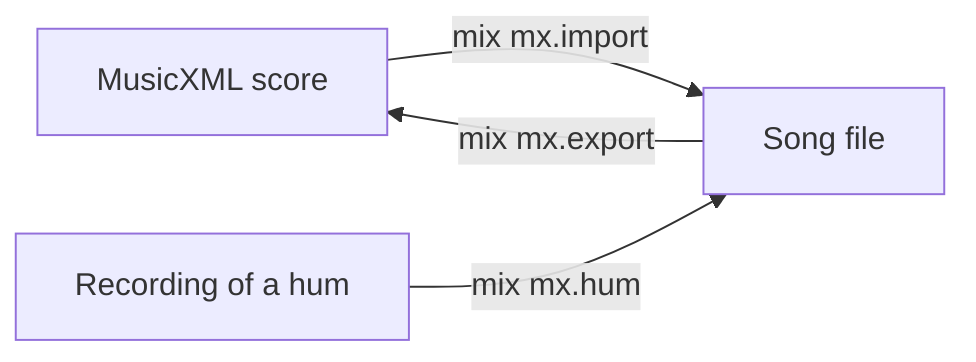

# Scores and hums

A song need not be typed in by hand.
mx writes one from a MusicXML score or from a recording of a melody you hum, and writes a song back out as a MusicXML score.
With the mx command installed, each `mix mx.NAME` task here is also `mx NAME` with the same arguments, as the README's Install section says.



## Import a score

`mix mx.import` turns a MusicXML score into a song, so a piece need not be typed in by hand.
MusicXML is the file format notation programs such as MuseScore, Sibelius and Finale export, and collections such as music21's corpus ship.
`examples/wachet_auf/bwv140.7.mxl` is Bach's chorale "Wachet auf, ruft uns die Stimme", BWV 140/7, from music21's corpus:

```sh
mix mx.import examples/wachet_auf/bwv140.7.mxl --tempo 72 --part "Soprano=oboe" --part "Alto=clarinet" --part "Tenor=viola" --part "Bass=bassoon" --out examples/wachet_auf/chorale.exs
mix mx.play examples/wachet_auf/chorale.exs
```

It reads compressed `.mxl` files and uncompressed `.musicxml` and `.xml` files, and writes the song beside the score, or to `--out`; a song that exists is refused unless you add `--force`.
Each part becomes a part of the song named after it, `--part "Soprano=oboe"` plays a part on a synth, and a part without one plays on tri.
mx prints each part's synth, how many notes it has, and its lowest and highest note.
`--tempo` sets the beats per minute, and without it the song takes the score's first metronome mark; a score without one needs `--tempo`.
A beat is a quarter note whatever the time signature, so a dotted quarter in 6/8 lasts 1.5 beats.

The song plays the score once, and ends.
Each part's bars are written in a module of their own, one to a line, as the bar's number and its music: `def bar(1), do: seq(eb4: 1, g4: 1, bb4: 1.5, bb4: 0.5)` is the soprano's first bar, and a bar of several voices plays them `together`.
Its modules are named after the song file and the part, such as `Chorale.Soprano`, so two imported songs with parts of one name load side by side.
A note tied over a bar line sounds for the whole tie, given as its sustain, and the note it ties into is a rest.
Notes play at vel 0.6, and a dynamic such as f sets how hard the notes after it in its voice play: pp at vel 0.3, p 0.45, mp 0.5, mf 0.6, f 0.8 and ff 1.
`order` lists the bars in the order the score plays them, its repeats and first and second endings taken, so the chorale plays bars 1 to 8 twice and then bars 9 to 18, and a bar that differs between its times through is written once for each.
Notes sound at the pitch they sound in the score, so a clarinet in Bb written on D5 plays C5.
A part whose bar is written shorter than the others' rests to the end of it, and notes written past the end of the time signature's bar are cut there, so the parts stay in time.
Grace notes, ornaments, articulations, fermatas, lyrics and tempo changes after the first are left out.

The song is ordinary mx code, so it is a place to start: give the bass a second part an octave down, add reverb, or hand it to an agent to arrange.

`examples/erbarme_dich/bwv244.39.mxl` is Bach's aria "Erbarme dich, mein Gott", BWV 244/39, from MuseScore, and takes its tempo from the score:

```sh
mix mx.import examples/erbarme_dich/bwv244.39.mxl --part "Violin=violin" --part "Alto=oboe" --part "Organo a canne=organ" --out examples/erbarme_dich/aria.exs
mix mx.play examples/erbarme_dich/aria.exs
```

Its D.S. al Fine is not taken, so the aria ends at bar 46 without going back to the opening ritornello.

`examples/erbarme_dich/dub.exs` turns the aria into a roots dub: a dub siren and the hand drums open it and the horns state its opening sigh, then the ritornello is the riddim, the drum kit leading with the one drop, ghost strokes and rolls over the congas playing Nyabinghi drums, the shaker and the güiro, the harp's skank and the organ's bubble over the continuo's bass; a trombone leads with the ritornello, slurring its runs, the harmonium and the horns sing the alto's phrase, and in the dubs the parts drop out into echo and filter sweeps, the tabla's bayan and the tanpura's drone:

```sh
mix mx.play examples/erbarme_dich/dub.exs
```

## Export a score

`mix mx.export` writes a song as a MusicXML score, which MuseScore, Sibelius and Finale open and print as sheet music:

```sh
mix mx.export examples/erbarme_dich/aria.exs --time 12/8 --key bm
```

It writes the score beside the song with the extension `.musicxml`, or to `--out`, compressed when that ends in `.mxl`; a file that exists is refused unless you add `--force`.
The score holds the whole of the song's music once, as `mix mx.print` prints it.
Each part that plays notes becomes a part of the score, and a part that plays no notes with a pitch, such as drums and samples, or that waits for input, is left out; mx names each one it leaves out.
mx prints how many notes each part has, and its lowest and highest note.
`--time` sets the time signature, 4/4 without it, and `--key` the key its notes are spelled in, such as `d`, `bm` or `fsm`, C major without it.
`--title` sets the title, which is otherwise the song file's name.

A note is written as long as its sustain when it is given one, and as long as its beats otherwise, a beat being a quarter note.
Starts and lengths snap to a 24th of a beat, which holds 32nd notes and triplets, and a note between semitones is written at the nearest one.
Notes of a part that start together and last as long are written as a chord, and notes that overlap otherwise go to as few voices as they need.
A note that crosses a bar line, or whose length no single note value writes, is written as tied notes.
The score's tempo is the song's starting tempo, as a metronome mark at the first bar.
Tempo changes after the first, dynamics, articulations and percussion staves are left out.

## Turn a hum into a song

`mix mx.hum` turns a recording of a melody you hum, sing or whistle into a song, so a tune you can't name the notes of can still get into mx:

```sh
mix mx.hum hum.wav --tempo 90
mix mx.play hum.exs
```

It reads WAV and AIFF files, mono or stereo, at any sample rate, and writes the song beside the recording, or to `--out`; a song that exists is refused unless you add `--force`.
`--tempo` is the tempo you hummed at, and is needed, since mx doesn't work out the tempo: hum against a click or a song you know, and give its tempo.
mx prints where it wrote the song, how many notes it found, and their lowest and highest note.

The song has one part, hum, on tri, playing the melody again and again as a `seq` of note names and rests, such as `seq(c3: 1, c3: 1, g3: 1, g3: 1, a3: 1, a3: 1, g3: 2)`.
Each note is the semitone nearest the pitch you held, in the octave you hummed it: a note held with vibrato or a wobble is one note, at the pitch it centres on, and a slide is the note it starts on and the note it lands on.
A break in the voice between two notes at one pitch makes them two notes; breath, clicks and noise are not notes.
The first note starts on beat 0, and every note starts and lasts a whole number of quarter beats.
A sound shorter than an eighth of a beat is left out, a silence of a quarter beat or less before the next note is a breath and joins the notes, and a longer one is a rest.
The melody lasts until the end of the bar of 4 beats its last note ends in.
It follows pitch from 60 Hz to 2500 Hz, from a low hum to a high whistle, and one voice at a time; words, chords and the key are left out.

`mix mx.hum --record hum.wav --tempo 90` records the hum for you, against a click:

```sh
mix mx.hum --record hum.wav --tempo 90
```

It plays a click at the tempo, a bar of 4 beats to count you in and then every beat, louder on the first beat of each bar, and records the sound card's first input until you press Enter; `--input 2` records another input.
It then prints how long the recording is and turns it into `hum.exs` as above, with beat 0 on the first beat after the count-in, so a melody you start on beat 1 begins with a rest of a beat.
A note you hum during the count-in is left out, and mx says how many were.
Use headphones, so the click stays out of the microphone; the click has no pitch, so a click the microphone picks up from speakers is not a note, but it can hide a quiet one.
A recording or song that exists is refused before the first click unless you add `--force`, and so is a folder that does not exist, and an input that runs at another sample rate than the output, such as Bluetooth headphones' microphone, naming both devices and their rates.

The song is text, so it is a way to hand a tune to an agent: hum the idea, run `mix mx.hum`, and ask an agent to build on `hum.exs`, harmonizing the melody, giving it a bass line and drums, or setting it on another synth.
The agent reads and writes the notes as mx code, and `mix mx.print hum.exs` shows them with their beats.
