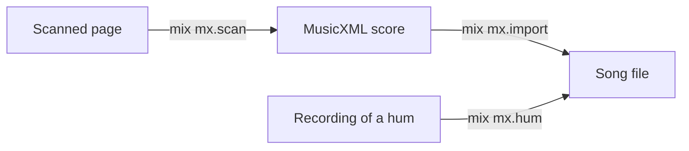

# Scores and hums

A song need not be typed in by hand.
mx writes one from a MusicXML score, from a scanned page of a printed score, or from a recording of a melody you hum.



## Import a score

`mix mx.import` turns a MusicXML score into a song, so a piece need not be typed in by hand.
MusicXML is the file format notation programs such as MuseScore, Sibelius and Finale export, and collections such as music21's corpus ship.
`examples/wachet_auf/bwv140.7.mxl` is Bach's chorale "Wachet auf, ruft uns die Stimme", BWV 140/7, from music21's corpus:

```sh
mix mx.import examples/wachet_auf/bwv140.7.mxl --tempo 72 --part "Soprano=oboe" --part "Alto=clarinet" --part "Tenor=viola" --part "Bass=bassoon" --out examples/wachet_auf/chorale.exs
mx examples/wachet_auf/chorale.exs
```

It reads compressed `.mxl` files and uncompressed `.musicxml` and `.xml` files, and writes the song beside the score, or to `--out`; a song that exists is refused unless you add `--force`.
Each part becomes a part of the song named after it, `--part "Soprano=oboe"` plays a part on a synth, and a part without one plays on tri.
mx prints each part's synth, how many notes it has, and its lowest and highest note.
`--tempo` sets the beats per minute, and without it the song takes the score's first metronome mark; a score without one needs `--tempo`.
A beat is a quarter note whatever the time signature, so a dotted quarter in 6/8 lasts 1.5 beats.

The song plays the score once, and ends.
Each part's bars are written in a module of their own, one to a line, as the bar's number and its music: `def bar(1), do: seq(eb4: 1, g4: 1, bb4: 1.5, bb4: 0.5)` is the soprano's first bar, and a bar of several voices plays them `together`.
Its modules are named after the song file and the part, such as `Chorale.Soprano`, so two imported songs with parts of one name load side by side.
A note tied over a bar line sounds for the whole tie, given as its sustain, and the note it ties into is a rest.
Notes play at vel 0.6, and a dynamic such as f sets how hard the notes after it in its voice play: pp at vel 0.3, p 0.45, mp 0.5, mf 0.6, f 0.8 and ff 1.
`order` lists the bars in the order the score plays them, its repeats and first and second endings taken, so the chorale plays bars 1 to 8 twice and then bars 9 to 18, and a bar that differs between its times through is written once for each.
Notes sound at the pitch they sound in the score, so a clarinet in Bb written on D5 plays C5.
A part whose bar is written shorter than the others' rests to the end of it, and notes written past the end of the time signature's bar are cut there, so the parts stay in time.
Grace notes, ornaments, articulations, fermatas, lyrics and tempo changes after the first are left out.

The song is ordinary mx code, so it is a place to start: give the bass a second part an octave down, add reverb, or hand it to an agent to arrange.

`examples/erbarme_dich/bwv244.39.mxl` is Bach's aria "Erbarme dich, mein Gott", BWV 244/39, from MuseScore, and takes its tempo from the score:

```sh
mix mx.import examples/erbarme_dich/bwv244.39.mxl --part "Violin=violin" --part "Alto=oboe" --part "Organo a canne=organ" --out examples/erbarme_dich/aria.exs
mx examples/erbarme_dich/aria.exs
```

Its D.S. al Fine is not taken, so the aria ends at bar 46 without going back to the opening ritornello.

`examples/erbarme_dich/dub.exs` turns the aria into a roots dub: a dub siren and the hand drums open it and the horns state its opening sigh, then the ritornello is the riddim, the drum kit leading with the one drop, ghost strokes and rolls over the congas playing Nyabinghi drums, the shaker and the güiro, the harp's skank and the organ's bubble over the continuo's bass; a trombone leads with the ritornello, slurring its runs, the harmonium and the horns sing the alto's phrase, and in the dubs the parts drop out into echo and filter sweeps, the tabla's bayan and the tanpura's drone:

```sh
mx examples/erbarme_dich/dub.exs
```

## Scan a score

`mix mx.scan` reads the music on a scanned score into MusicXML, ready for `mix mx.import`.
It runs Audiveris, an open source optical music recognition program, which is installed apart from mx as [audiveris.md](audiveris.md) describes, along with poppler for PDFs.
It also needs vix, and `--model` needs pythonx; both are optional dependencies of mx, so add `{:vix, "~> 0.43"}` and `{:pythonx, "~> 0.4.11"}` to your deps to scan.

```sh
mix mx.scan score.pdf
```

It reads a PDF, or a single page as a PNG, JPEG or TIFF image, and writes the MusicXML beside it, or to `--out`; a file that exists is refused unless you add `--force`.
`--pages 3-4` reads only those pages of a PDF, numbered as the PDF numbers them, and `--pages 5` reads one.

Before recognition it prepares each page the way Audiveris asks:

- It renders a PDF page at the resolution that puts its staff lines 20 pixels apart, measured on the page, and scales an image to the same.
- It turns the page to grayscale and leaves black and white to Audiveris.
- It crops the scanner bed and a neighbouring page off, and evens yellowed or unevenly lit paper to white.
- On paper still gray after that, as where ink shows through from the other side, it fades what is paler than the ink, keeping the thin sharp strokes such as faint staff lines.
- It turns a tilted page until its staff lines are level.

The prepared pages go in a folder beside the MusicXML, here `score-pages`, with Audiveris's book of each page and its logs, so you can see what recognition was given, and open a book in Audiveris to correct it.
`--raw` gives Audiveris the pages as they are, to compare.
mx prints each page's staff line spacing before and after, how many degrees it was turned, and how many bars Audiveris read on it, names a page it read no music on, and prints the `mix mx.import` command with a `--part` for each part found.
The parts of every page are joined in page order, a page's parts matched to the first page's in order.

Recognition is not exact, so listen to the song against the page.
On the chorale "Bin ich gleich von dir gewichen" of the Bach-Gesellschaft's St Matthew Passion, Audiveris finds the bass and tenor's notes nine times in ten and eight in ten, but misses the key signature after the soprano clef, so the top part reads naturals where the score has sharps; the part names are as it read them, misspellings included.
It reads no handwritten scores, such as Bach's autographs.

`--model` reads the music with a transcription model instead of Audiveris, which suits printed piano music, and photographs and photocopies of it, far better:

```sh
mix mx.scan rag.pdf --model
```

It cuts each prepared page into its systems, the staves a bar line joins, writes each 1400 pixels wide to the pages folder, transcribes them one by one into ABC notation, kept beside each system, and joins them into one score.
mx prints how many systems it found on each page, in place of the bars.
The model is rokot-omr-2b, free for non-commercial use under CC BY-NC 4.0, and reads a system of one part, of up to two staves, so it does not suit choral or orchestral scores such as the chorale.
It runs in Python inside mx through Pythonx: the first run installs Python and its packages with uv and downloads the model's 4.3 GB from Hugging Face, and needs no Audiveris.
`MX_TRANSCRIBER_MODEL` names another Hugging Face model or a local folder to use instead.
It takes about 7 seconds a system on an Apple silicon GPU.
On three pages of the Maple Leaf Rag it finds 94 notes in 100 both on the clean engraving and on a photograph of it, where Audiveris finds 97 and 23, and on a bad photocopy it finds 43.
`--raw` does not go with `--model`, which cuts the systems out of prepared pages.

## Turn a hum into a song

`mix mx.hum` turns a recording of a melody you hum, sing or whistle into a song, so a tune you can't name the notes of can still get into mx:

```sh
mix mx.hum hum.wav --tempo 90
mx hum.exs
```

It reads WAV and AIFF files, mono or stereo, at any sample rate, and writes the song beside the recording, or to `--out`; a song that exists is refused unless you add `--force`.
`--tempo` is the tempo you hummed at, and is needed, since mx doesn't work out the tempo: hum against a click or a song you know, and give its tempo.
mx prints where it wrote the song, how many notes it found, and their lowest and highest note.

The song has one part, hum, on tri, playing the melody again and again as a `seq` of note names and rests, such as `seq(c3: 1, c3: 1, g3: 1, g3: 1, a3: 1, a3: 1, g3: 2)`.
Each note is the semitone nearest the pitch you held, in the octave you hummed it: a note held with vibrato or a wobble is one note, at the pitch it centres on, and a slide is the note it starts on and the note it lands on.
A break in the voice between two notes at one pitch makes them two notes; breath, clicks and noise are not notes.
The first note starts on beat 0, and every note starts and lasts a whole number of quarter beats.
A sound shorter than an eighth of a beat is left out, a silence of a quarter beat or less before the next note is a breath and joins the notes, and a longer one is a rest.
The melody lasts until the end of the bar of 4 beats its last note ends in.
It follows pitch from 60 Hz to 2500 Hz, from a low hum to a high whistle, and one voice at a time; words, chords and the key are left out.

`mix mx.hum --record hum.wav --tempo 90` records the hum for you, against a click:

```sh
mix mx.hum --record hum.wav --tempo 90
```

It plays a click at the tempo, a bar of 4 beats to count you in and then every beat, louder on the first beat of each bar, and records the sound card's first input until you press Enter; `--input 2` records another input.
It then prints how long the recording is and turns it into `hum.exs` as above, with beat 0 on the first beat after the count-in, so a melody you start on beat 1 begins with a rest of a beat.
A note you hum during the count-in is left out, and mx says how many were.
Use headphones, so the click stays out of the microphone; the click has no pitch, so a click the microphone picks up from speakers is not a note, but it can hide a quiet one.
A recording or song that exists is refused before the first click unless you add `--force`, and so is a folder that does not exist, and an input that runs at another sample rate than the output, such as Bluetooth headphones' microphone, naming both devices and their rates.

The song is text, so it is a way to hand a tune to an agent: hum the idea, run `mix mx.hum`, and ask an agent to build on `hum.exs`, harmonizing the melody, giving it a bass line and drums, or setting it on another synth.
The agent reads and writes the notes as mx code, and `mix mx.print hum.exs` shows them with their beats.
